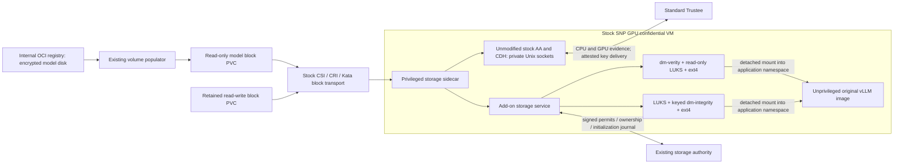

# Stock-Kata storage add-on

The actual Qwen workload has been migrated to this add-on. See the
[deployment guide and evidence](../../docs/confidential-storage/stock-kata-qwen-storage-addon.md)
for current validation and limits. A bootstrap-only probe is not end-to-end evidence.

This moves the storage integration into a trusted, privileged **guest container**.
The stock Kata runtime, agent, kernel and initrd are not replaced. The application
image is unchanged; its reviewed startup command waits for storage. vLLM remains
UID/GID 1001, drops every capability, disallows privilege escalation and has a
read-only root filesystem. Only the helper receives raw block devices.

The sidecar copies the **unchanged** AA/CDH executables and their libraries from
the pinned installed GPU initrd into its own image. It starts private instances
after the application container has been created, so the stock runtime has
already attached and initialized the GPU. This is necessary because AA selects
its additional GPU attester at startup. No new network key endpoint is exposed.
The supported guest-components kernel parameter disables the guest REST API;
the helper also refuses startup if port 8006 is listening.

The public ConfigMap carries the same InitData as the Pod annotation. Before
using the storage configuration, the unchanged SNP AA checks that InitData against
hardware HOST_DATA. Trustee and the authority must separately approve its exact
hash and the stock guest launch measurement. Merely starting AA does **not** prove
that Trustee accepted the CPU/GPU evidence.

## Build and prepare

1. `prepare-payload.py --base STOCK_GPU_INITRD --tools PUBLIC_TOOLS_TAR --output PAYLOAD.tar.gz`
   checks the pinned stock initrd and public tool bundle. It extracts AA, CDH,
   shared libraries and the stock dm-bufio module, plus the existing public
   cryptsetup/e2fsprogs tools and matching integrity modules. It never modifies
   the initrd. Inspect the generated inventory before publishing.
2. In the pinned Linux compiler environment, stage the adjacent storage components
   and their locked upstream dependency source, then run `build-service.sh`.
   **`--features trustee-rcar` is required**, including its private-CDH dependency.
3. Use `prepare-build.py` with the SHA-256 read directly from the successful
   compiler output, then build `Containerfile` with exactly four context files: `Containerfile`,
   `runtime.py`, `confidential-storage-service`, and `payload.tar.gz`. No volume
   keys, authority credentials, model files or cluster configuration belong in
   this context. Pin the resulting image digest.
4. Install the dedicated identity and admission guard with the Helm chart
   [`confidential-storage-sidecar`](../../charts/coco-supported/confidential-storage-sidecar/).
   Its guard must be present before granting access to its SCC. It restricts the
   service account to stock Kata RuntimeClasses and the reviewed helper/application
   images, rejects host namespaces and API tokens, and rejects raw devices or
   elevated privileges on the application container.
5. Run `prepare-qwen.py --help` and supply the current **public** preparation,
   KServe manifest, public AA/CDH bootstrap ConfigMap, new image digest and actual
   OpenShift build name. The generated package is only a candidate. It does not
   update Trustee, approve authority state, touch a PVC, or deploy a workload.

OpenShift injects its build name into the image environment. The exact value is
part of the reviewed helper policy; changing a build requires regenerating the
profile and InitData. The policy uses the stock runtime's captured OCI request
shapes. Different runtime/image versions require reviewing new request shapes,
not relaxing all request checks.

The internal registry must allow the guest to pull this public add-on image.
Host pull credentials are not automatically passed into the confidential guest.
The lab uses a narrowly scoped anonymous `imagestreams/layers` GET permission for
this one public add-on ImageStream on the internal ClusterIP registry. This must
never grant access to other images or be used to publish a context with secrets.

## Mount and lifecycle boundary

The pod shares its guest PID namespace, not the host PID namespace. The helper
accepts a Unix-socket rendezvous from the measured application command, checks
SO_PEERCRED, UID/GID, zero effective capabilities and `NoNewPrivs`, and pins the
process with a pidfd and opened root/mount-namespace descriptors.

The storage service retains its authority, manifest, initialization and key
handling code. Its optional `--sidecar-parent` mode admits only its root parent
process with the pinned executable inode and verifies that the parent has not
changed. The original agent integration remains the default. This modifies an
add-on component, not Kata.

After attested activation, the supervisor clones each private mount with
`open_tree`, enters the application's mount namespace/root and attaches the
detached tree with `move_mount`. It then enforces read-only/read-write and
`nodev,nosuid,noexec` flags before acknowledging startup. The application sees
`/models/qwen` and `/data`; it receives no disk, mapper-control or key-service
socket. Plaintext mount targets and rendezvous storage are guest-memory volumes.

Stock Kata signals the entire container cgroup on stop. Private children block
TERM/INT until the supervisor finishes volume closure; the helper installs its
signal handlers before bootstrap. The Linux `test_runtime.py` regression covers
child survival during this stop sequence.

The helper waits for the application to exit, removes its transferred mounts and
asks the service to close both volumes. An uncertain teardown retains authority
ownership; it must not automatically authorize a second writer. If supervision
fails, the application is killed. The helper is part of the trusted computing
base and has privileges within the guest; moving it to a sidecar does not remove
the need to trust the mount manager or eliminate CAP_SYS_ADMIN entirely.

Existing initialized `/data` must retain its key, initialization identity,
filesystem and authority journal. A policy upgrade requires closed Ready records;
never replace the retained authority database or reformat the existing PVC.

## Verification

The stock-engine test harness and captured request fixtures live under
[`tests/confidential-storage/stock-agent-sidecar`](../../tests/confidential-storage/stock-agent-sidecar/).
Generate cases with `prepare-policy-tests.py OUTPUT` and evaluate them using
`policy-check` against the exact stock Regorus revision. Tests cover intended
requests and injection of commands, privileges, raw/control devices, unsafe
mounts, file-copy traversal, exec and policy replacement.

Required rollout evidence additionally includes:

- Unchanged stock boot artifacts, actual QEMU arguments and independently
  calculated launch measurement; unchanged application image digest.
- CPU **and** GPU appraisal by standard Trustee, with exact InitData binding.
- Real populated RO model PVC and all producer file hashes. The real workload
  checks the RO mount flag; the separate synthetic sidecar test also tests `EROFS`.
- Existing RW PVC reopened without formatting; persistence across fresh VMs.
- GPU inference and storage chatbot response; original Qwen remains healthy.
- Administrator `oc exec` denied, and application unable to access raw devices,
  private sockets or helper key memory.

The existing `ConfidentialVolume` controller's approved package describes the
earlier agent-integrated mount path. Its compilation/publication contract still
needs a reviewed representation of separate transport and consumer containers
before it can automate this add-on. Manually rendered candidates must not be
reported as automatically reconciled, approved workloads.
