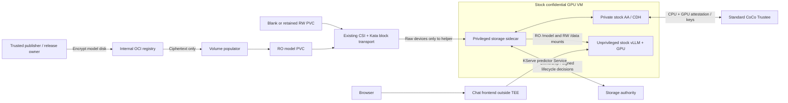

# Architecture and supported configuration

For the complete execution sequence, read the [workload walkthrough](workload-walkthrough.md)
and [component map](components.md).

## What runs

Qwen3-0.6B runs through KServe in a stock confidential GPU VM. A privileged
**guest-side storage sidecar** opens encrypted block volumes and transfers mounts
into stock, unprivileged vLLM: `/model` read-only, `/data` read-write. The chat
frontend calls the KServe predictor. No Kata or vLLM source changes are required.

## Components and ownership

| Component | Owner / role |
| --- | --- |
| OSC/Kata, GPU runtime, Trustee, CSI, GitOps, KServe | Existing platform; reused, not replaced |
| `EncryptedModelSource` + volume populator | Add-on; verifies OCI ciphertext, populates a prime PVC, rebinds its PV to the requested claim |
| `ConfidentialVolume`, `ConfidentialWorkload`, binder, controller | Add-on; binds actual PVC UIDs, requests approval, verifies the signed package, reconciles KServe + public InitData |
| Storage sidecar | Add-on; private stock AA/CDH binaries, storage client/service, cryptsetup and mount transfer; privileged only inside the VM |
| Storage authority | Add-on; retained ownership, first-use journal, signed decisions and manifest identity; **no volume keys** |
| Trusted publisher/enroller/signer | Add-on tools and Jobs; plaintext preparation, key provisioning, trust bindings and deployment approval |
| Chat frontend | Add-on; HTTP proxy to inference, no cluster credentials |

The helper starts private copies of stock AA/CDH after GPU attachment; AA checks
InitData against SNP HOST_DATA. The helper authenticates the application over a
Unix socket, pins its process/mount namespace, and transfers mounts with
`open_tree`/`move_mount`. vLLM receives filesystem mounts, not decryption keys.

The authority/publisher/enrollment environment is trusted. Colocation on the demo
cluster does not protect their credentials or history from that cluster's administrator.
The inference host and storage backend are treated as untrusted for workload data.

The [target GitOps control path](automation.md) adds Argo-managed release intent
and a trusted release reconciler around these components. Current Argo ownership
covers the controller foundation; full preparation/enrollment/acceptance automation
remains to be implemented.

## Data protection

| Path | Protection and lifecycle |
| --- | --- |
| `/model` | Publisher creates LUKS ciphertext + dm-verity tree. Approved root authenticates the ciphertext **including its LUKS header**. Guest verifies identity, obtains the key, opens RO and checks file hashes. |
| `/data` | New claim needs explicit first-use approval. Guest journals LUKS format → keyed dm-integrity initialization → ext4 creation → durability barrier. Later VMs reopen the retained volume; they do not format again. |
| Keys | Standard Trustee gates model/data/helper-pull resources on CPU + GPU evidence, expected launch measurement and exact InitData. Private CDH retrieves them inside the guest. |
| Application | UID/GID 1001, zero capabilities, no raw storage devices/private key sockets, read-only root filesystem; administrator exec denied by measured Kata policy. |

Storage hardware attestation is unnecessary for this threat model: ciphertext is
untrusted and authenticated in the guest. Availability remains the storage backend's
responsibility. Keyed dm-integrity detects modification but **does not prevent
replay of a complete older RW snapshot**. The RO manifest/root and authority
policy reject an unauthorized model generation; authority history must itself be
protected against rollback. These are not claims of general RW anti-rollback.

The current chat is HTTP and terminates outside the TEE. Encrypted weights/storage
do not establish end-to-end confidentiality for prompts; guest-terminated TLS is a gap.

## Qualified hardware and software

“Qualified” means passed this repository's demo, not an upstream vendor support tier.

| Dimension | Demonstrated configuration |
| --- | --- |
| CPU / architecture | AMD SEV-SNP, x86_64; valid CPU certificate/TCB verification and approved launch identity |
| GPU | **NVIDIA RTX PRO 6000 Blackwell Server Edition**, one passed-through confidential GPU per predictor; CPU + GPU appraisal required |
| Platform | OpenShift 4.22.15, OSC 1.13 stock guest, KServe 0.20.0 |
| Runtime | `kata-cc-nvidia-gpu` / `kata-snp-nvidia-gpu`; `nvidia.com/pgpu` on the tested site |
| VM sizing | Current renderer fixes 8 vCPUs and 64 GiB guest RAM; host needs additional platform/runtime capacity |
| Storage | Tested `lvms-vg1` / TopoLVM, raw Block, `ReadWriteOncePod`, `Immediate`; model 2 GiB, data 1 GiB, authority 1 GiB in demo |
| Producer | Separate trusted CPU workload; chart limits 4 CPUs / 16 GiB RAM with 12 GiB memory-backed build scratch |
| Model / application | Pinned Qwen3-0.6B and NVIDIA vLLM image; exact digests in the [receipt](../tests/evidence/2026-10-15/manual-quickstart-e2e.json) |

Intel TDX, other GPU models, other OSC/vLLM versions, other CSI implementations,
WFFC, multi-GPU and multi-replica serving are **not qualified here**. The installer
currently accepts only `osc-snp-nvidia-x86_64-v1`; a new platform needs a reviewed
runtime/attestation profile and the same hardware E2E gates.
