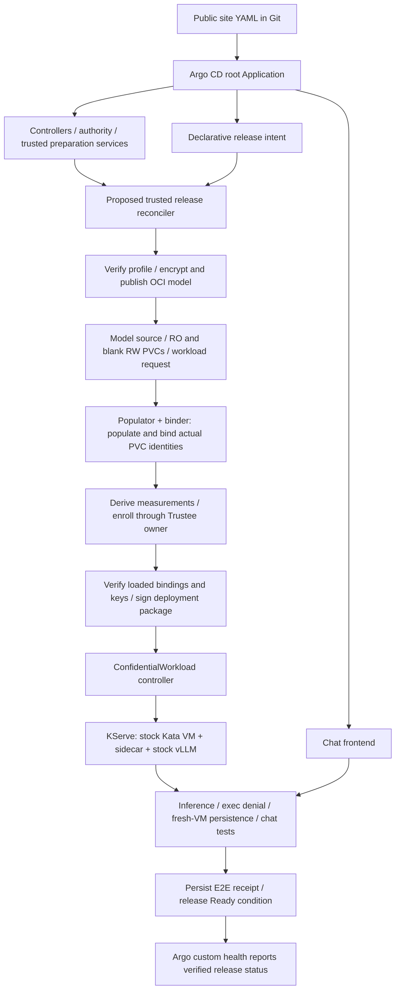

# GitOps lifecycle: target and current boundary

**Target operating model:** install CoCo, perform one administrator bootstrap,
then supply one public site-values YAML in Git. Argo CD reconciles the add-on and
release intent; trusted controllers/Jobs prepare, enroll, sign and verify the demo.
Routine deployment requires no manual `oc apply`, signing or enrollment commands.
**Full lifecycle reconciliation is not implemented yet.**

Implementation sequence and acceptance gates: [full lifecycle plan](full-lifecycle-implementation-plan.md).

The plan requires two maintained entry points: a complete [manual Makefile
quickstart](demo/quickstart-implementation-plan.md), delivered first, and GitOps
orchestration over the same operations. The manual path still uses the existing
volume/workload controllers, but does not need the new release orchestrator.

## Inputs and bootstrap

The site YAML selects installation identity, qualified hardware profile, pinned
model/images, registry, storage sizes/classes, Trustee integration and chat exposure.
It references credentials; it never contains them. The target consolidates today's
[separate input locations](inputs.md), including trusted preparation settings.
Generated digests, PVC identities, measurements and approvals are controller outputs,
not values the user must copy between commands.

One-time administrator work establishes repository access, external secret/backend
identities, signer trust, retained authority storage and permission to manage the
add-on's CRDs/RBAC/SCC. Bootstrap installs the root Application and restricted
AppProjects. Existing CoCo/Trustee owners retain their resources. Credentials and
keys stay in the trusted backend; Git records public configuration and references.

Use a site configuration repository/revision watched by the root Application;
child Applications pin the pattern code to reviewed commits. A change to the site
YAML triggers reconciliation. Code upgrades require an explicit pin change.
The [Argo CD app-of-apps pattern](https://argo-cd.readthedocs.io/en/stable/operator-manual/cluster-bootstrapping/)
provides the application hierarchy; its root configuration is administrator-controlled.

## Resource ownership

| Owner | Desired state / responsibility |
| --- | --- |
| Argo CD | Add-on controllers, authority service, preparation services, chat, credential references and declarative release intent |
| Proposed trusted release reconciler | Durable preparation/enrollment Jobs and receipts; derived model descriptor, volume/workload requests, measured package and signed approval |
| Volume populator | Ciphertext import Jobs, prime PVC and populated claim binding |
| ConfidentialVolume/workload controller | Bound volume identities, verified deployment package, public InitData and KServe InferenceService |
| KServe | Predictor Deployments/Pods and serving lifecycle |
| Guest sidecar + authority | Attested key retrieval, approved first-use initialization, mount transfer and retained ownership history |
| Existing Trustee owner | Policy/reference-value/resource updates through its approved integration; verify running KBS has loaded them |

Each object/spec field has one writer. Argo must not also template a generated
InferenceService, approval or prime PVC. Controller outputs remain runtime state;
GitOps does not require putting keys, approvals or every derived manifest in Git.
Separate trusted-preparation permissions from workload permissions; the workload
controller never receives the signing key or enrollment credentials.

## Reconciliation and readiness

Use [sync waves](https://argo-cd.readthedocs.io/en/stable/user-guide/sync-waves/)
for infrastructure ordering, with explicit health checks for child Applications
and release resources. Waves alone do not prove enrollment or inference. The
release reconciler waits on durable conditions before each dependent operation.
Its release API and Argo health mapping still need implementation.

Run destructive acceptance actions, including graceful test-VM replacement, once
per explicitly requested test release/generation; never on every Argo resync or
health check. Continuous health checks must not reformat or restart serving VMs.

## Implementation gaps

| Stage | Available today | Required for target |
| --- | --- | --- |
| GitOps foundation | Restricted Application; controller/security charts; self-heal, pruning disabled | Root/child Applications for the full add-on; scoped trusted namespace/project; watched site YAML |
| Preparation | Pinned fetch/encrypt/publish tools | Trusted release API/reconciler, idempotent Jobs and durable receipts; publish portable images |
| Measurements | InitData/policy hashes computed; launch measurement supplied | Verify hardware profile and derive expected launch identity from approved boot artifacts and exact VM parameters |
| Enrollment | CAS key writer, authority journal, binding checks | Existing-owner integration, parameterized backend mapping, loaded-policy/resource gates and credential renewal |
| Deployment | Binder + signed-package controller create KServe | Automatically prepare/sign packages under preauthorized profiles and reconcile chat |
| Acceptance | Startup probes and executable E2E verifier | Scheduled release steps, retained evidence and custom health; Ready only after required tests pass |

**Current GitOps detail:** the Application renders only `charts/confidential-inference`.
It receives an inline `helm.valuesObject` snapshot at bootstrap; `gitops.valuesFile`
is not a watched Helm values source. Its project does not permit the trusted Jobs,
PVCs or release resources needed above. Today's [setup commands](demo/setup.md)
remain necessary until these gaps are implemented.

## Retry and retention rules

Persist keys, authority history, PVC identities and step receipts. Reconciliation
must not regenerate keys, repeat completed formatting, reset history or take over
an uncertain writer. Protect retained resources from pruning; deletion needs an
explicit retirement workflow. Git rollback cannot undo an initialized disk or
restore authority state safely.

Expected measurements come from approved artifacts/configuration, not whatever a
host reports. Automatic discovery cannot approve unknown firmware, a disk wipe
or an unauthorized model generation. Reject deviations instead of widening policy.
Kata, vLLM and shared CoCo services remain stock.
