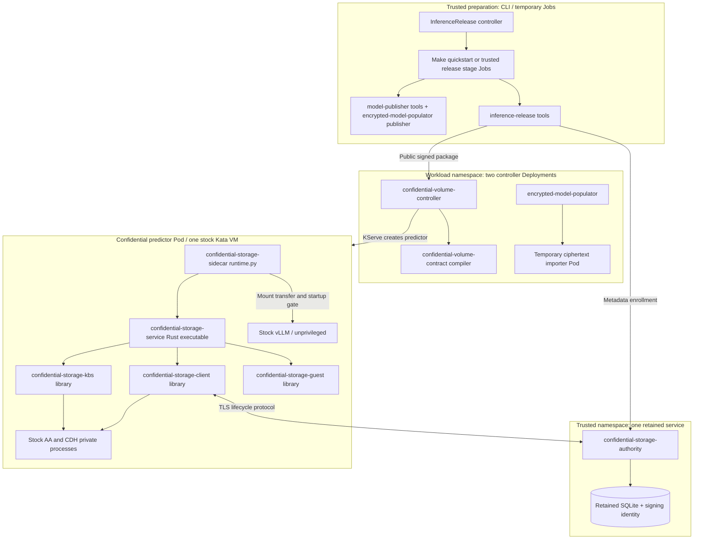

# Components and interfaces

Start with the [workload walkthrough](workload-walkthrough.md) for declarations,
sequence diagrams, disk layouts and failure handling. This page maps repository
directories to **running processes**: twelve source directories do not mean twelve
services. Most storage libraries compile into one executable inside the sidecar.

## Deployment map

The chat proxy is one additional Pod outside the VM. Steady state therefore has
two controllers, authority, predictor and chat; build, publisher, binding and
enrollment Jobs are temporary. Controller-driven installations add one release
controller Pod and a separate retained orchestration PVC; stage Jobs are temporary.
Existing platform services are additional.

## Source directory roles

Paths below are under [`components/`](../components/).

| Directory | Runs where / responsibility | Interface and sensitive state |
| --- | --- | --- |
| [confidential-volume-contract](../components/confidential-volume-contract/) | Python library in controller and release tools; validates claims/bindings and makes deterministic approval requests | Public Kubernetes snapshots in, request JSON out; no network or keys |
| [confidential-volume-controller](../components/confidential-volume-controller/) | Namespace controller; discovers declarations, verifies approval and reconciles permitted KServe targets | Kubernetes API, public Ed25519 verifier, immutable request/approval artifacts; no signer or storage keys |
| [encrypted-model-populator](../components/encrypted-model-populator/) | Go controller + temporary importer; handles prime PVC population/rebind. Python publisher programs also live here | OCI ciphertext/digests and raw import device; importer has no decryption key. Publisher is a separate trusted role |
| [model-publisher](../components/model-publisher/) | Pinned userspace/tool and kernel-module preparation for publisher/helper builds | Public source locks and verified binaries; `charts/model-publisher` runs the trusted preparation Job |
| [inference-release-controller](../components/inference-release-controller/) | Trusted reconciler + sequential stage Jobs; exact site grant, deterministic Jobs, durable receipts, explicit retry | Retained orchestration PVC holds signer/key state; workers receive scoped external credentials. [Bootstrap and lifecycle](demo/controller.md) |
| [inference-release](../components/inference-release/) | Trusted offline/Job tooling; render policy, enroll authority metadata/resources, create public measured package | Request/profile/descriptors in; package out. Enrollment/signing steps use separately scoped private credentials |
| [confidential-storage-sidecar](../components/confidential-storage-sidecar/) | Python supervisor in privileged guest container; private process startup, app authentication, mount transfer, shutdown | Local rendezvous and root-private service socket; owns namespace descriptors and guest storage privileges |
| [confidential-storage-service](../components/confidential-storage-service/) | Rust daemon child of supervisor; coordinates all volumes and reservations | Private `activate-many`/`close` RPC; calls the three libraries below; never exposes a network key API |
| [confidential-storage-client](../components/confidential-storage-client/) | Rust library in service; attested authority sessions and signed receipt/initialization verification | Authority TLS and private AA ttRPC; ephemeral guest session signing key, grants and permits |
| [confidential-storage-kbs](../components/confidential-storage-kbs/) | Rust library in service; checks permits and calls stock CDH `GetResource` | Root-private CDH ttRPC; exact URI/encoding, zeroizing key bytes; no Trustee server implementation |
| [confidential-storage-guest](../components/confidential-storage-guest/) | Rust library in service; receipt/manifest/header validation, LUKS/verity/integrity execution and mount lifecycle | Approved block descriptors and profile; guest kernel/tools; private mounts returned to service |
| [confidential-storage-authority](../components/confidential-storage-authority/) | Python TLS service in trusted domain; durable volume registration, generation, first-use journal and exclusive ownership | Standard Trustee RCAR authentication, signed receipts, SQLite; TLS/receipt private keys, **no volume decryption keys** |

`confidential-storage-client` and `confidential-storage-kbs` are add-on adapters to
**existing APIs**. They do not modify upstream AA, CDH, KBS or AS. The guest library
name does not mean a replacement guest image. The sidecar image carries this code;
the stock kernel/initrd/agent and vLLM image remain unchanged. Reviewed matching
kernel modules are loaded inside the guest; compatibility is profile-specific.

The administrator-side [`scripts/quickstart/integrations.py`](../scripts/quickstart/integrations.py)
configures Vault enrollment ACL/role, preserves or initializes the backend record,
and commits ESO/Trustee wiring through the existing CoCo owner. It materializes a
pinned chart adapter when needed; it is not a long-running controller. The external
Vault administrator credential is used only for bootstrap. See [inputs and flow](demo/stock-bootstrap.md).

## Platform components reused

| Component | Responsibility in the running workload |
| --- | --- |
| OSC / stock Kata runtime + agent | Launch confidential Pod VM, attach devices, create containers and enforce measured agent policy |
| Stock AA (Attestation Agent) | Collect CPU and NVIDIA evidence; validate InitData against hardware binding |
| Stock CDH (Confidential Data Hub) | Guest-side image/resource access using KBS attestation; not the Trustee server |
| Standard Trustee KBS + AS (Attestation Service) | Verify evidence, appraise policy and gate resource release |
| Vault + ESO (External Secrets Operator) | Current trusted backend and resource projection into KBS; not a guest mount path |
| Existing CSI | Allocate/attach raw blocks; sees encrypted bytes, never gets a LUKS credential |
| KServe | Reconcile InferenceService into predictor compute/Service and readiness; does not decrypt weights |
| OpenShift registry | Store pinned add-on images and encrypted model OCI artifact as distinct objects |
| Argo CD | Existing platform/foundation ownership and Trustee values synchronization; may own the immutable InferenceRelease intent after administrator bootstrap; full foundation lifecycle and renewal remain open |

## Installer and chart entry points

| Entry point | Installs or performs |
| --- | --- |
| `make/quickstart.mk`, `scripts/quickstart/` | Manual staged orchestration, immutable run identity, private journals, build/push, trust enrollment and E2E receipts |
| `charts/addon-bootstrap` | Restricted Argo AppProject + pinned foundation Application; skips shared CRDs |
| `charts/vendor/confidential-volumes` | CV/CW CRDs, controller RBAC and deployment admission guard |
| `charts/vendor/encrypted-model-populator` | Source CRD, populator/importer RBAC and controller |
| `charts/vendor/confidential-storage-sidecar` | Dedicated service account, SCC and admission guard; actual helper is rendered into the predictor |
| `charts/inference-release`, `charts/volume-binding` | Source/PVC/CW declarations and actual-UID binding Job |
| `charts/model-publisher`, `charts/storage-enrollment` | Trusted temporary preparation/enrollment Jobs |
| `charts/storage-authority` | Bootstrap or serve the same retained authority state; these are distinct modes |
| `charts/inference-chat` | Stateless HTTP chat UI/proxy to the predictor Service |

## Distinct keys and artifacts

| Material | Holder / use |
| --- | --- |
| Model/data LUKS credentials | Trusted preparation/backend, then private guest service after Trustee release; unlock disks |
| Helper registry credential | Scoped pull identity in Trustee; stock guest retrieves it to pull the pinned helper image |
| Deployment approval Ed25519 key | Trusted release signer; controller gets only verifier; authorizes one exact public deployment package |
| Authority receipt Ed25519 key | Authority; guest gets verifier in measured configuration; signs lifecycle decisions |
| Authority TLS key / CA | Server identity / guest trust pin; independent of receipt signing |
| Trustee AS signing key | Existing Trustee; authority verifies with pinned public signer |
| Guest P-256 session key | Ephemeral private guest memory; proves possession for challenge-bound authority requests |
| InitData, manifests, profiles and OCI digests | Public authenticated configuration; identities, not credentials |

The registry/importer/CV controller never need a volume key. Trusted release workers prepare and provision keys, so their retained orchestration state is sensitive. The authority needs
trusted metadata and signing credentials, but does not hold the volume key.
