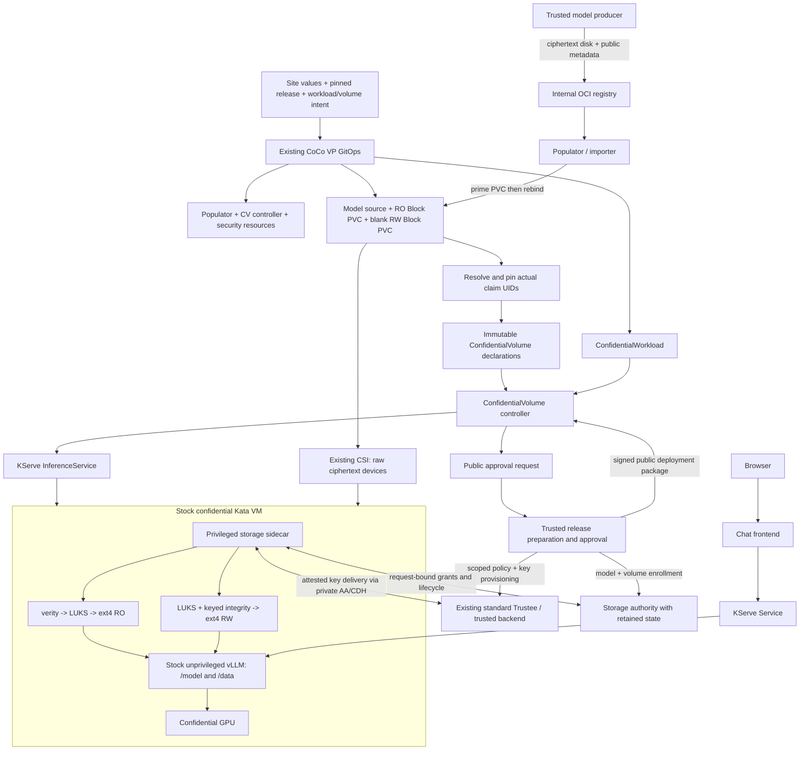

# Confidential inference add-on pattern: implementation plan

> Historical design specification. For the current implementation use
> [architecture](architecture.md), [inputs](inputs.md) and [demo setup](demo/setup.md).
> Proposed commands and old status statements below are not the current interface.

**Status: proposed implementation, researched 14 October 2026.** This document
does not claim that a clean-cluster installer or a second hardware profile has
already passed. The current implementation baseline is commit `858e523` on
`dev/confidential-storage-integration`. No live workloads were changed to prepare
this plan.

## Decision and feasibility

Create a **new, separate Git repository** for the confidential-inference add-on
pattern, installed only after CoCo is ready. Build it for an already installed CoCo
Validated Pattern. Reuse its GitOps instance, stock CoCo runtime, standard Trustee,
secret infrastructure and CSI driver. Package our encrypted storage add-ons,
KServe integration and Qwen chat example as separately versioned Helm charts and
images. Do not install a second competing owner of KataConfig, Trustee, Vault,
GPU ClusterPolicy or cluster-scoped serving resources.

This is feasible. The difficult runtime path already works: stock Kata, stock
vLLM, privileged storage helper, unprivileged application, encrypted RO/RW PVCs,
CPU/GPU-gated keys and real inference. The remaining work is reproducible
bootstrap, packaging, generic configuration, trust automation and qualification.
It is more than copying the working manifests into Helm.

Make configuration and orchestration hardware-independent, with **explicitly
qualified runtime/attestation profiles**. Initially qualify AMD SEV-SNP + NVIDIA
confidential GPU on stock OSC. Next qualify Intel TDX + NVIDIA. CPU-only inference
is a separate optional profile and must never count as a passing GPU demo.
Unqualified hardware fails preflight; it must not silently disable attestation,
integrity or GPU confidentiality to get a green deployment.

The target user journey is documented in the companion
[clean-install demo specification](qwen-clean-cluster-demo-plan.md). Proposed
values are in [the values example](https://github.com/pmatouse/coco-pattern-edge-rtx6k/blob/ebfaf34/docs/confidential-storage/examples/inference-pattern-proposed-values.yaml).
These are implementation contracts, not commands supported by today's checkout.

## Evidence and repository review

| Inspected input | Pinned revision / observation | Implication |
| --- | --- | --- |
| [Yuval's confidential-inference](https://github.com/yuvalk/confidential-inference/tree/c1d61bfaff93b965d8da2e699fb6a939ea121a83) | HEAD `c1d61bf`, committed 5 October 2026 | Useful two-role pattern skeleton; not the complete encrypted-storage demo |
| [Official CoCo pattern](https://github.com/validatedpatterns/coco-pattern/tree/aa04a093268be8ac92174313848a4c44298fbc41) | HEAD `aa04a093` at inspection | Pin this baseline and the companion charts; do not assume our fork's additions are upstream |
| Our add-on | `858e523`; [live evidence](https://github.com/pmatouse/coco-pattern-edge-rtx6k/blob/ebfaf34/tests/confidential-storage/evidence/2026-10-14/controller-sidecar/) | Controller-managed adoption/recreation, RO hashes, persisted RW data, CUDA, chat and exec denial passed |
| Read-only cluster inspection | OpenShift 4.22.15; `kserve/kserve-controller:v0.20.0`; `kata-cc-nvidia-gpu` maps to `kata-snp-nvidia-gpu` | Record exact image digests in the new release lock; a tag is not a reproducible pin |
| Storage inspection | `lvms-vg1`, `topolvm.io`, `Immediate`, reclaim policy `Delete`; VolumePopulator CRD serves `v1beta1` | Existing success does not qualify delayed binding or a different CSI backend; protect demo PVCs from pruning |

### What to reuse from Yuval's repository

The inspected repository has `values-trustee.yaml`, `values-inference.yaml`,
`charts/trustee-config`, `charts/coco-config` and `charts/vllm`. Its useful design
choice is separating a trusted key service from the workload cluster, without
requiring ACM. Preserve that topology option and its Vault/ESO configuration idea.

Specific source findings:

- [`charts/vllm/templates/deployment.yaml`](https://github.com/yuvalk/confidential-inference/blob/c1d61bfaff93b965d8da2e699fb6a939ea121a83/charts/vllm/templates/deployment.yaml)
  creates a Deployment, not a KServe InferenceService. It sets `HF_TOKEN` to a
  literal `kbs:///...` string; the repository supplies no resolver in that
  container path. Comments alone do not establish that stock vLLM dereferences it.
- [`charts/trustee-config/values.yaml`](https://github.com/yuvalk/confidential-inference/blob/c1d61bfaff93b965d8da2e699fb6a939ea121a83/charts/trustee-config/values.yaml)
  explicitly contains bring-up defaults: empty reference values and allow-all
  resource policy. Our add-on must require scoped release rules instead.
- [`charts/coco-config/values.yaml`](https://github.com/yuvalk/confidential-inference/blob/c1d61bfaff93b965d8da2e699fb6a939ea121a83/charts/coco-config/values.yaml)
  defaults to peer pods. This is not a portable prerequisite for our bare-metal path.
- There is no encrypted model publisher/populator, managed RW volume lifecycle,
  ConfidentialVolume controller or chat E2E suite in that tree. No top-level README
  or license file was present; establish reuse/licensing terms before copying code.

Recommendation: align naming and the trusted/workload topology with Yuval, but
implement the add-on using our tested components. Do not deploy his default
`coco-config` or `trustee-config` over an installed CoCo pattern. No source changes
to Yuval's repository are required for this planning stage.

### Upstream context that affects the design

- Validated Patterns exposes applications, subscriptions and values composition
  through ClusterGroup. Use that integration surface for the add-on, with one
  owner per shared object. A second independent pattern bootstrap is not needed
  on the existing cluster. [ClusterGroup configuration](https://validatedpatterns.io/learn/clustergroup-in-values-files/)
- KServe Standard mode uses ordinary Kubernetes serving resources and supports
  the explicit resource control needed here. Pin a tested release and avoid
  introducing Knative solely for this single-replica demo.
  [KServe installation guide](https://kserve.github.io/website/docs/admin-guide/kubernetes-deployment)
- Custom volume population graduated to GA in Kubernetes 1.33. That does not
  make our custom populator, its local library patch, or every OpenShift/CSI
  combination supported. Qualify the exact stack and install the registration
  CRD/validator only when absent and compatible.
  [Upstream graduation](https://kubernetes.io/blog/2025/05/08/kubernetes-v1-33-volume-populators-ga/)
- OSC documents guest-side encrypted block volumes and NVIDIA confidential GPU
  configuration. Our addition is the combined model/data lifecycle and delivery
  to an unprivileged application, not a new CSI or Kata encryption feature.
  [OSC configuration](https://docs.redhat.com/en/documentation/openshift_sandboxed_containers/1.13/html/deploying_confidential_containers_on_bare-metal_servers/configure-cc-overview_metal-cc)

## Starting point and acceptance target

“Zero” means **CoCo VP installed and healthy, with no resources from this demo**.
It does not mean an empty OpenShift cluster or unconfigured firmware. Preflight
must separately establish a usable stock confidential runtime, required TEE/GPU
configuration, real attestation, reachable Trustee, suitable Block CSI and image
registry. An installed CoCo VP alone does not prove confidential GPU readiness.

The initial release must create its own namespace, source, PVCs, declarations,
authority enrollment and approval. It must not copy the existing cluster's PVC
UIDs, retained database, keys, signed approvals, InitData or captured OCI fixtures.

Acceptance target:

1. Produce a pinned Qwen3-0.6B encrypted LUKS/verity model artifact and publish it
   to the internal registry. A trusted producer is allowed to see plaintext/key.
2. Populate a new model Block PVC through `EncryptedModelSource` and the custom
   populator. Importers see ciphertext and transport metadata only.
3. Create a separate blank RW Block PVC. Initialize LUKS + keyed dm-integrity and
   ext4 only inside the attested guest, under explicit first-use authorization.
4. Use the existing ConfidentialVolume/ConfidentialWorkload controller to deploy
   a KServe predictor with an unprivileged stock vLLM container and trusted helper.
5. Serve from **`/model`** and use **`/data`** for writable state/cache. The current
   lab uses `/models/qwen`; supporting the requested `/model` requires a deliberate
   destination allowlist and policy update, not just a values substitution.
6. Show actual GPU inference through the chat app, persistence after fresh-VM
   replacement, and security failures when approvals/content/evidence are wrong.
7. Repeat install/resync/restart without repopulating the bound model, reformatting
   data, rotating keys, resetting the authority, or taking over another workload.

Public Qwen weights demonstrate the encrypted distribution and authorization
mechanism; their public availability is not a model-secrecy claim.

## Architecture and ownership



| Resource / concern | Owner | Explicit boundary |
| --- | --- | --- |
| OSC, KataConfig, guest/runtime, GPU operator and device configuration | Base CoCo VP / platform administrator | Add-on preflight reads them; it does not rewrite them |
| Trustee KbsConfig, existing resource policy/RVPS, Vault and ESO | Base CoCo VP / trusted administrator | Add scoped values through the existing owner's supported extension; never a second competing ConfigMap |
| KServe CRDs/controller | Existing installation, or optional pinned add-on application if absent | Default `existing`; reject incompatible versions/ownership rather than overwrite |
| Demo source/PVC intent, workload intent, chat and namespace policy | Add-on Helm/GitOps | Preserve claims and exclude generated InferenceService from Argo ownership |
| Prime PVC/importer and handoff | Model populator | No decryption credential; restricted PV rebind permission remains necessary |
| Resolved CVs with actual PVC UIDs | Idempotent binding job | Create/compare, never silently rebind or change immutable CVs |
| Approval request/configuration/generated InferenceService | Existing CV controller | Public key verification only; no key reads, signing or formatting |
| Release generation, model authorization and deployment signature | Trusted release process | Outside the untrusted workload control plane in separated deployments |
| Initialization/history/ownership | Additional storage authority | Durable state; not part of stock Trustee and not a source of volume keys |
| Device-mapper, initialization, mount transfer, private AA/CDH | Sidecar inside the TEE | Privileged trusted code; vLLM receives directories, not raw devices/key sockets |

Trustee and authority may be colocated with the workload for a **trusted-lab demo**.
For the hostile-workload-cluster threat model they belong in a separately trusted
administrative domain, as does the release signer. A PVC holding the authority DB
on the hostile cluster is not independent rollback protection.

## Packaging the add-on as a pattern

Create `confidential-inference-pattern` as the first implementation deliverable
(proposed location: `pmatouse/confidential-inference-pattern`; final owner/name is
an implementation-time choice). It is a separate Git repository and release
lifecycle, similar to Yuval's arrangement. **Do not keep the new pattern as a
permanent branch or overlay inside the CoCo pattern repository.** This document
lives in the current fork only to preserve the planning handoff.

Create it with deliberately selected visibility (keep it private until public
release review), without transferring credentials or private lab files. Initialize
the new repository with an explicit license, README, maintainer and
security contacts, pinned framework dependency, values schema, CI, and an empty
add-on install skeleton. Import our reusable components with source commit and
license provenance, or consume their pinned published charts/images. Avoid
copying the historical lab tree, private scratch or old patched-agent path.

The new repository owns its namespace-scoped inference/storage configuration and
release artifacts. It declares compatibility with a stock CoCo VP release and
reads the installed platform contract. It does not vendor or reinstall the CoCo
operator/runtime. Our current fork-specific Trustee chart bindings must become a
supported companion-chart extension/configuration contract; until then declare
the exact required chart release rather than claiming arbitrary stock VP support.

Two integration entry points, with the same application charts:

- **Separate repository install (default):** run the new repository's explicit
  `install-addon` target against an installed CoCo cluster. It performs preflight
  and creates a uniquely named root Argo Application and restricted AppProject
  in the existing GitOps instance. That root points to this new repository and
  its pinned add-on chart. No change to the CoCo Git repository is required for
  ordinary add-on resources. Do not run a generic framework bootstrap that
  silently creates a second GitOps/Vault/OSC/Trustee installation.
- **Optional CoCo catalog integration:** the base pattern can register that same
  root/chart as a ClusterGroup application, referring to the separate repository
  and release. This is an alternative owner of the root Application, not a second
  simultaneous installation. Keep the default separately installable.

The new repo may provide distinct trusted-service and inference-cluster values,
as Yuval does. Each role reuses CoCo/Trustee and GitOps already installed in its
administrative domain. ACM is optional. Provisioning a whole CoCo base from an
empty cluster is outside this add-on's first release.

Existing shared-service configuration still follows its owner: a Trustee extension
is supplied as reviewed values/configuration to the existing Trustee application
or through its supported API. The new root must not continually overwrite a
CoCo-managed policy ConfigMap. Preflight identifies this integration prerequisite
and the guide specifies the one-time base-owner action where needed.

Proposed layout (new paths, not implemented yet):

```text
README.md / LICENSE / SECURITY.md   # separate project and maintenance contract
pattern.sh / Makefile               # explicit install-addon, no base reinstall
charts/addon-bootstrap/             # root Application + scoped AppProject
charts/confidential-inference/       # integration/root chart, references pinned children
charts/inference-foundation/         # namespace, RBAC, admission, network/registry trust
charts/storage-authority/            # move reusable runtime resources out of tests/
charts/inference-release/            # public release input, source/PVCs, binding job, CW
charts/inference-chat/               # generic model/backend/endpoint, from qwen-chat
charts/inference-validation/         # optional synthetic test client and evidence jobs
profiles/runtime/<profile>.yaml     # reviewed stock runtime/guest compatibility descriptor
profiles/attestation/<profile>.yaml # issuer/claim rules, expected TEE and GPU bindings
releases/<version>/lock.json         # exact code/chart/image/tool/model revisions
overrides/sites/edge-rtx6k.yaml       # site-only values, no reusable generic defaults
ansible/                            # idempotent integration tasks where Helm cannot suffice
tests/e2e/                          # clean install, retained restart, negative tests
docs/demo/                          # runnable quickstart, presenter guide, recovery/cleanup
```

Reuse the existing populator, confidential-volumes and sidecar security charts;
do not fork them into near-identical copies. Promote generic authority deployment
from `tests/confidential-storage/gpu-guest/chart` into a maintained chart. Charts
must be Helm v3 (`apiVersion: v2`), with schemas, explicit namespaces, immutable
image pins and externally supplied secret references. Keep `/common` untouched.

Do not rely on a parent's sync-wave annotation alone to mean all child
Applications are healthy. Define health checks and readiness gates for CRDs,
operators, PVC population, authority readiness and approved workloads. CRD
upgrade ordering needs explicit management; Helm does not upgrade files under
`crds/` on an ordinary upgrade.

### One-time installs versus per-demo resources

| Scope | Required |
| --- | --- |
| Already supplied by base | OSC/CoCo, GPU configuration for GPU profile, standard Trustee, GitOps and secret backend, block CSI; registry if already enabled |
| Optional install when absent | Compatible pinned KServe Standard installation; registry support; VolumePopulator registration CRD/validator |
| New maintained add-ons | Populator controller/importer; CV/CW controller and CRDs; guest sidecar image; sidecar SCC/admission; storage authority; release/binding tooling; generic chat chart |
| Trusted one-time setup | Deployment signer/keyring, authority TLS/receipt credentials and retained state, scoped backend roles, approved compatibility profiles and trust roots |
| Per model release | Source revision/hashes, encrypted artifact, model credential, approved manifest/generation, model PVC/source |
| Per data volume | Blank claim identity, separate credential, explicit initialization approval and retained authority record |
| Per workload version | Resolved bindings, measured public configuration, scoped Trustee identity rules, signed package with expiry and renewal policy |

The pattern must render an installation inventory before applying anything,
showing `reuse`, `create`, `configure-through-existing-owner` or `incompatible`.
No implicit upgrade of an existing KServe/Trustee/OSC installation.

## Hardware portability contract

Use versioned public descriptors verified by the trusted release process, not an
arbitrary user-supplied list of acceptable evidence. Site values select a reviewed
profile; they cannot redefine success as missing GPU evidence.

| Profile | Initial status | Required qualification |
| --- | --- | --- |
| AMD SNP + NVIDIA CC, bare metal, x86_64 | Existing runtime path demonstrated; first release target | Full fresh install, first-use RW through sidecar, generic names/paths and packaging |
| Intel TDX + NVIDIA CC, bare metal, x86_64 | Proposed second profile | TDX InitData measurement/binding, CPU+GPU composite evidence, compatible stock guest/modules, full hardware E2E |
| SNP or TDX CPU-only | Optional later profile | CPU-capable stock vLLM image, CPU evidence path, no NVIDIA dependency, distinct acceptance report |
| Peer pods / cloud | Unqualified | Provider block attachment, topology, stock guest capabilities and attestation; do not infer support from `kata-remote` existing |
| Other accelerator / architecture | Unqualified | Vendor confidential mode and evidence verifier, inference image, guest ABI and policy support |

A profile must bind: architecture; runtimeClass; stock guest image/kernel/firmware
identity; userspace and kernel-module compatibility; TEE claim interpretation;
InitData binding; GPU evidence/count and resource name; permitted device/CDI
policy; key trust roots; mount-transfer support; and supported storage profiles.
Site identity (firmware/TCB references, issuer, node selection) is supplied and
reviewed separately. Auto-detection can report capabilities, not authorize them.

Specific portability gaps in today's code:

| Current source | Constraint | Required change |
| --- | --- | --- |
| [`prepare-payload.py`](https://github.com/pmatouse/coco-pattern-edge-rtx6k/blob/ebfaf34/components/confidential-storage-sidecar/prepare-payload.py) and [`runtime.py`](https://github.com/pmatouse/coco-pattern-edge-rtx6k/blob/ebfaf34/components/confidential-storage-sidecar/runtime.py) | Fixed GPU initrd/tools hashes, RHEL kernel module path, x86_64 syscall numbers and NVIDIA nodes | Compatibility-descriptor-driven packaging; supported architecture adapters; verify kernel/module ABI; prefer stock built-ins when present |
| [`prepare-qwen.py`](https://github.com/pmatouse/coco-pattern-edge-rtx6k/blob/ebfaf34/components/confidential-storage-sidecar/prepare-qwen.py) | Migration from old prepared output, exactly two volumes, fixed workload/path/hostname and captured OCI fixtures | Pure generic renderer from current declarations, pinned image metadata and profile; no previous deployment or private scratch dependency |
| [`sidecar.py`](https://github.com/pmatouse/coco-pattern-edge-rtx6k/blob/ebfaf34/components/confidential-volume-controller/sidecar.py) | Fixed GPU RuntimeClass, UID 1001 and container roles | Validate against approved runtime/application profile; retain one unprivileged application and single-owner rollout in v1 |
| [`private_rcar_aa.rs`](https://github.com/pmatouse/coco-pattern-edge-rtx6k/blob/ebfaf34/components/confidential-storage-client/src/private_rcar_aa.rs) | Rejects non-SNP; always obtains NVIDIA additional evidence | Explicit SNP/TDX and CPU/GPU adapters with negative binding tests; no generic accept-any-TEE path |
| [`attestation.py`](https://github.com/pmatouse/coco-pattern-edge-rtx6k/blob/ebfaf34/components/confidential-storage-authority/attestation.py) | Some TDX/optional-GPU types exist, but tested RCAR/composite path is SNP/NVIDIA | Audit actual verification branches and signed claim binding for each profile; declarations alone are not support |
| [`resource-policy.yaml`](https://github.com/pmatouse/coco-pattern-edge-rtx6k/blob/ebfaf34/charts/hub/trustee-edge/templates/resource-policy.yaml) | Storage-key bindings require SNP launch SHA-384 + InitData SHA-256 | Generic scoped workload-binding interface in Trustee chart, with TEE-specific claim validators and tests |
| [`compiler.py`](https://github.com/pmatouse/coco-pattern-edge-rtx6k/blob/ebfaf34/components/confidential-volume-contract/compiler.py) | `/models`, `/data`, `/checkpoints`; 8 volumes; 64 GiB cap | Add reviewed `/model` root; keep caps explicit in v1; larger models need measured InitData and storage-size work |
| Publisher and test utilities | Pinned Qwen embedded in older producer, fixed namespace/name assumptions | Standalone model release manifest, generic test run IDs and inputs; preserve strict content verification |

Changing a RuntimeClass value alone cannot satisfy these changes. Keep all custom
code in our add-ons; a profile that needs a patched Kata or vLLM image fails the
stock-component acceptance gate.

## Reproducible trust and release lifecycle

### Inputs, secrets and immutable outputs

Use four distinct identities: model release ID, demo run ID, storage volume ID and
workload configuration digest. Reusing a run ID must compare existing state and
resume; a mismatch blocks. A fresh run gets new names/UIDs and a new RW key. Reusing
an immutable model artifact may reuse its controlled release key; every new data
volume still gets its own key and initialization record.

| Material | Location / access |
| --- | --- |
| Model plaintext and encryption credential during publication | Trusted producer only; not the workload namespace, importer or controller |
| Model/data credentials at rest | Existing trusted Vault/KBS backend, separate scoped resources |
| Authority receipt key and TLS private key | Trusted authority secret backend; never a public release artifact |
| Deployment signer private key | Trusted release environment or approved signing service; controller gets public keys only |
| Registry credentials | Separate bounded publisher/importer identities; guest pull credentials delivered through a qualified confidential path when required |
| Public outputs | OCI/source digests, model manifest, runtime descriptor, request hash, measured InitData, public certificates and signed approval |

Replace the lab scripts' reads of the bootstrap `imperative/vaultkeys` root token
with scoped backend identities. Do not turn those scripts into general controller
permissions. Use create-if-absent/CAS semantics and explicit reconciliation of
uncertain writes; retries never generate a replacement key for an existing disk.

### State sequence and dependency cycle resolution

1. **Preflight / release lock:** resolve versions and compatibility before any
   key or disk operation. Obtain approved reference values from trusted artifacts
   and provisioning records; observed host measurements are verification inputs,
   not values automatically promoted to trusted reference values.
2. **Trusted producer:** acquire pinned Qwen files, verify hashes, prepare the
   encrypted image and verity root, verify reopen, publish ciphertext by digest.
   Keep build scratch private. Prefer a trusted external runner; a regular
   publisher pod on an untrusted cluster is not a confidential producer. The
   internal `.svc` registry hostname may be unreachable from that runner: use a
   verified reachable registry endpoint, or transfer only ciphertext plus public
   metadata to a restricted in-cluster uploader. The uploader never receives the
   model key; verify its returned digests against the trusted producer output.
3. **Provision transport:** apply immutable source and RO/RW Block claims. Wait
   for population and provisioning. Do not release keys merely because PVCs bind.
4. **Bind declarations:** a restricted idempotent job reads actual claim UIDs and
   creates immutable CV objects. It compares existing objects on retry and refuses
   a same-name replacement. Helm owns the intent/PVCs; this job owns resolved CV
   creation. Avoid Helm `lookup` as the primary GitOps identity-binding mechanism.
5. **Generate request:** Helm creates CW; the CV controller resolves it and emits
   the signed-package request. Missing declarations can remain Pending/Blocked
   until step 4, without launching an unapproved inference VM.
6. **Prepare public release:** a generic deterministic renderer uses request,
   manifest and profile to build helper configuration, agent policy, InitData and
   final predictor. Pin image metadata and expected OCI shapes from reviewed
   artifacts, not a permissive live capture of the first unknown workload.
7. **Enroll trust:** the trusted process registers the approved RO manifest and
   RW first-use identity, configures scoped Trustee rules, and ensures required
   credentials exist. Retain state across every retry. Do not store the approval
   signature or ephemeral service/pod UIDs inside the bytes being hashed: that
   would make the measurement depend on its own output.
8. **Approve deployment last:** verify the expected Trustee policy is loaded and
   authority enrollment matches; sign the exact request/package. Publication of
   this public approval unlocks controller deployment. A failure between steps
   leaves the workload undeployed or unable to receive keys.
9. **Attest / initialize / serve:** fresh guest evidence authenticates storage
   operations; private CDH obtains keys; RO verifies and opens; RW journals first
   initialization or reopens; mount transfer completes; vLLM starts.
10. **Renew / update:** renew the same exact request under the trusted release
    policy before expiry. New images, mounts, model release or runtime identity
    require a new measured configuration and scoped authorization. Revocation and
    stopping already-running inference are separate lifecycle actions.

No general auto-signer on the workload cluster. The first release may use a
documented explicit trusted approval command; an optional trusted job can approve
only preauthorized release/profile combinations. Its rejection reasons and
idempotent receipts must be visible. No opaque manual edits to generated YAML.

Authority runtime configuration is currently coupled to a workload's InitData.
For v1, support one isolated authority instance/state per demo release (reusable
across VM restarts), or implement a bounded multi-identity verifier registry before
sharing it. Do not update a shared verifier to the latest workload and silently
break other consumers. Cross-release migration needs a deliberate protocol.

The current test chart refuses to start without a pre-existing retained DB. Add
an explicit create-once authority bootstrap/enrollment job with exclusive state
access; do not copy the old seed database. Its fresh-state mode is separate from
restart mode, which still refuses missing history. Establish stable service/TLS
names before rendering InitData, but start the workload-specific verifier after
public configuration/enrollment is ready. Do not put an authority-Ready gate
before the request/renderer that supplies that authority's InitData: that would
create another bootstrap dependency cycle.

### Scheduling and delayed binding

The current lab uses `Immediate`; this is the first qualified storage profile.
`WaitForFirstConsumer` has a real dependency cycle: controller approval requires
Bound claims, while provisioning/population may wait for a scheduled consumer.

For that profile, implement and test a scheduler-driven placement stage before
identity binding: a restricted no-key/no-write reservation consumer references
the claims and the same eligible-node/topology constraints. After provisioning
and population it exits; wait for attachment release before the confidential
workload. Bind the final placement to the resulting PV topology. The design must
also account for GPU capacity, without assuming a reservation pod permanently
reserves a GPU. Never forge `selected-node`, disable topology checks or format a
claim in the placement pod. Until this path passes, reject WFFC with a clear
preflight reason rather than hang or label it supported.

## Implementation work packages

| ID | Deliverable / concrete changes | Depends on | Exit condition |
| --- | --- | --- | --- |
| P0 | Create the separate Git repository; scaffold install-addon/bootstrap, CI, license, release lock and preflight/ownership report | None | Correctly distinguishes installed CoCo from GPU readiness; rejects unsupported runtime/CSI/issuer and detects existing owners |
| P1 | Generic values schema and runtime profile contract; remove lab names from chart defaults | P0 | Helm renders two different namespaces, workload names, mount paths and site values without edge literals |
| P2 | Reproducible published helper/controller/populator/authority images, SBOMs and compatibility descriptors | P0–P1 | Build from versioned sources/locks, no `/tmp` cache or previous guest scratch; stock Kata/vLLM digests retained |
| P3 | Generic public renderer and controller profile validation; add `/model`; parameterize identity and bindings | P1–P2 | Multi-volume contract tests, strict privilege/device separation and negative InitData tests pass; no adoption required for new workload |
| P4 | Maintained authority/security/foundation charts; scoped Vault/ESO roles; durable bootstrap and enrollment tool | P1–P2 | Fresh state/credentials created once; repeat and uncertain-outcome tests preserve them; no root-token harvesting |
| P5 | Generic model manifest + trusted publication and OCI distribution workflow | P1–P2 | Clean Qwen download/encryption/publication; importer verification; new model PVC Bound; failed digest never handed off |
| P6 | Binding job, public request-to-package workflow, trusted approval/renewal and Trustee-chart integration | P3–P5 | New live PVC/CW UIDs resolved automatically; exact policy/enrollment verified before approval; no copied lab signature |
| P7 | KServe existing/install modes and generic chat chart; model/data startup self-tests | P3, P6 | New Qwen serves from `/model`; `/data` used; chatbot traces to exact GPU inference pod; no duplicate KServe owner |
| P8 | Fresh-install stock-sidecar RW initialization and complete positive/negative E2E harness | P4–P7 | All gates in demo specification pass on blank resources, then a second fresh VM reuses data without formatting |
| P9 | GitOps composition, idempotence/resume, retention, upgrades and cleanup | P0–P8 | Repeat sync/controller restart changes no keys/disks; one explicit documented install flow; generic run evidence |
| P10 | Second site and TDX/NVIDIA profile; WFFC qualification | P3, P8–P9 | Same application charts and demo procedure pass on additional hardware/storage; no code edits in Kata/vLLM |
| P11 | Upstream contributions and supported release packaging | P8–P10 | Maintainers accept chart/API changes; publish tested compatibility matrix and documented support boundaries |

P0–P9 produce the first complete add-on demo release. P10 is required before
claiming demonstrated cross-TEE portability. It is not a reason to delay designing
the generic API now. Other accelerators, shared RW storage, automatic crash
takeover and very large models are outside v1.

### Highest-priority implementation details

- **First-format sidecar test:** today's stock-sidecar evidence reopens existing
  RW storage. Run a genuinely blank PVC through authority approval, LUKS format,
  integrity initialization, filesystem creation, ownership setup, Ready commit,
  write/fsync and reopen. This is a release blocker, not documentation cleanup.
- **Provisioning idempotence:** persist release/run receipts and backend CAS
  versions. Resume after a registry push, key write, enrollment or approval upload
  with an uncertain response; do not create a second key or repeat disk format.
- **Retention:** implement Argo prune/delete controls and independent claim/state
  ownership. A Helm `resource-policy: keep` annotation alone is not an Argo
  retention guarantee. Never make data PVCs garbage-collected dependents of a
  replaceable workload or short-lived bootstrap Job.
- **Chat access:** use the generic KServe backend URL directly, parameterize all
  service/model/port names, and remove dependency on the old Kubernetes API proxy
  fallback. The chat workload should not need cluster credentials or exec access.
- **Generated ownership:** Argo manages CW; our controller manages IS; KServe
  manages Deployment/Pods. Do not let two reconcilers repeatedly rewrite the
  predictor. PVCs/authority history have independent retention.
- **Privileged helper admission:** templates alone do not grant safe access.
  Install/type-check restrictive admission before SCC permission; qualify policy
  enforcement inside the guest for the exact OCI/device shape. No wildcard exec,
  debug SSH or exposed CDH REST endpoint as a demo shortcut.
- **Registry access:** keep encrypted model repositories private as required.
  Public redistribution of reviewed add-on code is a separate choice. A Kubernetes
  pull secret on the host is not proof that stock guest pulls can authenticate;
  preflight and test the intended guest pull mechanism and CA trust.
- **Model/data freshness:** approved manifests and retained authority generations
  provide release selection. dm-verity/integrity alone do not prevent whole-volume
  replay. Do not describe the existing lab authority as a complete hostile-host
  RW anti-rollback solution; independent retention/fencing and epoch protocols
  remain separate work.
- **Image and chart versions:** pin dependency/image/model hashes. A stock image
  is unchanged vendor/upstream content, not an unreviewed floating tag. Qualify
  guest userspace/module licenses and redistribution before publishing bundles.

## Endpoint and prompt confidentiality

Provide `ClusterIP` + local port-forward for the generic default. A site can choose
VPN NodePort (our current demonstration) or a DNS/TLS-backed Route. Do not depend
on sslip.io or an automatically resolvable cluster wildcard domain.

An edge-terminated HTTPS Route protects browser-to-router transport; it does not
keep prompts confidential from the router, chat backend or host network. Label the
demo's network boundary accurately. Guest-terminated TLS with an attestation-bound
identity is a separate profile: it needs certificate/key delivery, passthrough
routing and a client trust/attestation story, plus a freshly approved policy. Do
not describe it as implemented by switching `route.tls` on.

## Testing, evidence and release criteria

Maintain three independent suites:

1. **No-hardware CI:** Helm schemas/rendering, source/image pin checks, authority
   and controller tests, deterministic rendering, malformed declarations,
   signer/expiry/binding rejection, privilege boundaries, interrupted bootstrap
   and restart idempotence. These do not prove confidential execution.
2. **Integration CI:** disposable CSI/registry/controller environments, population
   failure/handoff, RBAC/admission and KServe reconciliation. Use mocks only with
   explicitly non-confidential labels and never publish a hardware PASS from them.
3. **Real confidential-hardware E2E:** the clean-install runbook, blank RW first use,
   actual CPU/GPU attestations, RO verified model load, inference, durable writes,
   fresh VM, denied exec and isolated negative tests.

Evidence must include source/OCI/disk/file digests; actual source/PVC/CW/IS/pod UIDs;
stock runtime and image identities; request/approval digests and expiry; verified
CPU/GPU appraisal; mounts/privilege checks; initialization counters; persistence
marker; chat endpoint-to-pod trace and inference counter; and cleanup outcome.
Keep private keys, raw tokens, publisher scratch and arbitrary user prompts out
of reports. Application log markers supplement independent attestation/identity
checks; they are not cryptographic proof on their own.

Do not pass a clean-install gate by reusing this cluster's existing two claims.
Do not pass recreation automatically if stale API records need human cleanup:
record that limitation and reproduce/fix the underlying infrastructure behavior
or fail the unattended-recovery subtest. Never force-clear authority ownership as
a normal retry action.

Existing repository-wide checks are not a clean baseline: `preview-all` is absent
from the current Make targets and `validate-schema` hits missing
`global.hardware.profile` in the shared chart. The new pattern must have its own
working render/schema CI with all required values; resolve compatibility with the
pinned framework instead of disabling failed checks or editing `/common`.

## Upstream and integration boundaries

| Destination | Proposed contribution |
| --- | --- |
| CoCo Validated Pattern | Optional inference add-on application; ownership/reuse contract; profile and image-lock conventions; scoped Trustee chart configuration; documented base prerequisites |
| Trustee companion chart | TEE-aware per-resource workload bindings and reference-value composition, preserving existing policies/resources; backend enrollment interface and tests |
| CoCo/Kata ecosystem | Document/private API compatibility for stock AA/CDH, measured configuration, block transport and OCI policy shapes; qualification feedback. No Kata source patch required by the target path |
| Storage add-on project | Maintain CV/CW controller, helper, authority and publisher/populator as versioned components with stable APIs, lifecycle tests and security boundaries |
| CSI populator library | Submit or remove the local same-namespace extension; keep provenance and tests until upstream behavior suffices |
| Yuval's pattern | Offer reusable generic charts/values and the separated trusted/workload topology; coordinate reuse after license and maintainer review |

Using the framework does not itself grant an official Validated Pattern support
tier. Publish the initial result as an experimental/sandbox add-on with the exact
qualification matrix; pursue project review separately.

## Decisions to resolve during implementation

These do not block the proposed architecture, but must be recorded before the
corresponding release gate:

- New repository owner, name, visibility and licensing/provenance of imported
  code; no copying Yuval's unlicensed tree without clarifying reuse terms.
- Exact supported CoCo/Trustee companion-chart release exposing scoped resource
  bindings; our local `trustee-edge` chart is not automatically a stock dependency.
- Distribution rights and authenticated pull method for stock NVIDIA vLLM and
  the unchanged guest binaries/modules in the helper package.
- Trusted producer/signer/authority placement: colocated trusted lab versus a
  separate trusted cluster/backend. This changes the threat boundary, not the
  application values format.
- Access to a second TDX/NVIDIA system and another CSI topology for qualification.
  Unsupported matrix entries remain explicitly unqualified until tests run.
- External URL/DNS/TLS ownership if a shared browser link is desired. Port-forward
  remains the generic zero-DNS demo path; existing VPN endpoints stay unchanged.

## Implementation order recommendation

First create the separate repository and its non-disruptive add-on install entry
point. Then make a fresh SNP/NVIDIA run work using declarative inputs and the existing
stock images, including **newly initialized `/data`**. Then package that flow into
GitOps with scoped trusted provisioning and repeatability tests. Finally qualify
the second TEE and delayed-binding storage. At every stage keep the original
Qwen service intact and use new isolated demo names; capacity must be available
before any live test is scheduled.
