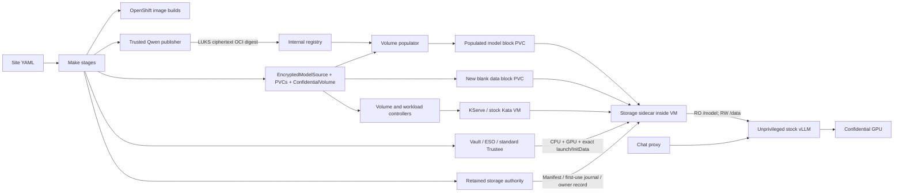

# Manual Qwen E2E quickstart

Start with **OpenShift + the CoCo Validated Pattern**, a qualified confidential
CPU/GPU, and raw-block storage. This path builds and installs the add-on, prepares
new encrypted model/data volumes, and tests Qwen through KServe and a chat UI.
Kata and vLLM remain stock. There is no release-orchestration controller: Make
invokes each operation; the volume/workload controllers and populator still run.

**Tested 2026-10-15:** a fresh add-on namespace, images, encrypted model, keys,
PVCs and authority history reached `E2EPassed`; [receipt](../../tests/evidence/2026-10-15/manual-quickstart-e2e.json).
The existing CoCo cluster and compatible shared CRDs were reused. Both first-boot
and fresh-VM chat/storage checks passed; this was not a cluster reinstall.

## Inputs

| Input | Source / requirement |
| --- | --- |
| Cluster access | Private `KUBECONFIG`; permission to install add-on CRDs/RBAC, build images, read approved stock runtime artifacts, and manage this demo |
| Hardware/runtime | Currently `osc-snp-nvidia-x86_64-v1`: AMD SEV-SNP, NVIDIA confidential GPU, OSC 1.13, `kata-cc-nvidia-gpu`; tested hardware is RTX PRO 6000 Blackwell Server Edition |
| Pod capacity | Five steady add-on Pods: two controllers, authority, predictor and chat. Preparation/import Jobs also need scheduling headroom; completed build compute is cleaned up |
| GPU capacity | One free `nvidia.com/pgpu`; 8 vCPU / 64 GiB guest. Preparation runs on CPU. No automatic eviction |
| Storage | Existing `Immediate` raw-Block CSI StorageClass supporting the profile's access modes; model 2 GiB, data 1 GiB, retained authority 1 GiB |
| Serving | KServe v0.20.0 in Standard mode; cert-manager; existing OpenShift internal registry available |
| Site YAML | Unique installation/run/namespaces, stable cluster ID, node, StorageClass, Trustee origin/public certificate references, GitOps owner mapping, Vault enrollment identity |
| Owner access | Git credentials allowing a commit to the declared Trustee owner's values file; Argo must consume that file |
| Scoped key enrollment | Vault Kubernetes-auth role and ServiceAccount, standard `secret/data/hub/modelKeys` backend and ESO projection; see [bootstrap](vault-bootstrap.md) |
| Downloads | GitHub, PyPI, Go, Rust crates, Debian packages, Hugging Face, pinned base registries, and the profile's signed Red Hat guest-kernel RPM URL (or an approved mirror) |
| Local scratch | Python 3.12+, Helm **3**, `oc`, Git, curl; allow several GiB for compiler/artifact caches. No local Docker daemon needed |

Site YAML contains public configuration and credential **references**, never key
bytes, tokens, kubeconfig or signed approvals. New model/data/authority/signing keys
are generated during the run. Keep `.private/quickstart/<run>` backed up securely;
retained authority history and PVCs are part of the installation, not disposable cache.

The stock GPU runtime and firmware must already be enabled by the platform owner.
This quickstart does not provision OpenShift, enable GPU CC mode or replace OSC.
The runtime artifact lock is deliberately narrow; another guest/kernel/TEE requires
qualification and new reviewed pins, not accepting whatever measurement is observed.

## Start

```sh
git clone https://github.com/pmatouse/confidential-inference-pattern.git
cd confidential-inference-pattern
export KUBECONFIG=/private/path/cluster.kubeconfig
oc whoami
helm version --short                         # v3.x
cp overrides/sites/quickstart.example.yaml overrides/sites/my-site.yaml
# Edit public site inputs; use new run, namespace and key-resource names.
export VALUES=overrides/sites/my-site.yaml
# Optional: put disposable caches outside a synchronized Documents directory.
export QUICKSTART_CACHE=/private/tmp/confidential-inference-build-cache
make qs-tools VALUES="$VALUES"
```

Expected: `ToolsReady`. Python dependencies are installed in an isolated environment
under the cache. On macOS with Helm 4 also installed, prepend
`/opt/homebrew/opt/helm@3/bin` to `PATH`. Keep the same `VALUES` and cache environment
for subsequent commands. Do not edit a run's inputs after starting it: use a new run
or an explicit retained-volume migration.

## One-time backend identity

If the CoCo administrator has not provided the scoped enrollment identity, run
these commands once with an **already authenticated Vault administrator session**.
They grant no Vault access to the workload namespace. Replace the auth mount and
trusted namespace with the site YAML values; keep administrator credentials out of
values files and command arguments.

```sh
oc create namespace confidential-inference-enrollment
oc -n confidential-inference-enrollment create serviceaccount confidential-inference-enroller
vault policy write confidential-inference-enroller - <<'POLICY'
path "secret/data/hub/modelKeys" { capabilities = ["patch"] }
path "secret/metadata/hub/modelKeys" { capabilities = ["read"] }
POLICY
vault write auth/hub/role/confidential-inference-enroller \
  bound_service_account_names=confidential-inference-enroller \
  bound_service_account_namespaces=confidential-inference-enrollment \
  audience=vault token_policies=confidential-inference-enroller \
  token_no_default_policy=true token_ttl=900 token_max_ttl=3600
```

Expected: policy and role writes succeed. `qs-bootstrap` verifies a short-lived
scoped login. This role can patch the shared KV document; its runner is trusted.
The base CoCo owner must already map that document through ESO to `model-keys`
and render `kbs.resourcePolicy.modelKeyBindings` into Trustee's resource policy.
The quickstart adds exact bindings through that owner; it refuses an incompatible
owner rather than replacing a shared policy with a broad allow rule.

If KServe is missing, set `quickstart.dependencies.installKServe: true` before the
first run. `qs-dependencies` installs `kserve-crd` and `kserve-resources` v0.20.0
with Standard mode and ingress creation disabled, after checking cert-manager.
Compatible existing KServe is reused. Storage, the internal registry and cert-manager
remain platform-owned dependencies; their installation depends on the cluster's
storage/network topology and is not silently changed by this add-on.

## Run each stage

Each command prints its result and the next command. Stop on any failed gate;
retain its state and rerun that target after fixing the cause.

| Command (`VALUES="$VALUES"` on each) | Expected result | Action performed |
| --- | --- | --- |
| `make qs-dependencies` | `DependenciesReady` | Check existing CoCo, KServe and registry; refuse incompatible shared services |
| `make qs-preflight` | `PlatformReady` | Record cluster/node/runtime/storage and namespace ownership; report GPU allocation |
| `make qs-bootstrap` | `BootstrapReady` | Create isolated namespaces, scoped SAs, authority trust/signing material and registry CA references |
| `make qs-build` | `BuildsComplete` | Fetch hash-pinned inputs; compile/test Rust and Go in a CPU-only pod; build five images using OpenShift binary builds |
| `make qs-push` | `ImagesPinned` | Verify images pushed by OpenShift builds and resolve every add-on image to its digest |
| `make qs-install` | `FoundationReady` | Install controllers, populator, RBAC and retained authority bootstrap |
| `make qs-model` | `ModelPublished` | Fetch pinned Qwen3-0.6B; generate model/data keys; prepare LUKS2 + verity disk in trusted CPU scratch; push ciphertext OCI; erase plaintext scratch |
| `make qs-volumes` | `VolumesBound` | Create/populate model PVC, create blank data PVC, bind actual UIDs and obtain public workload request |
| `make qs-measure` | `ReleaseMeasured` | Calculate SNP launch digest from approved stock bytes; generate exact workload policy and per-claim initialization plan |
| `make qs-enroll` | `TrustReady` | Enroll authority metadata, generate InitData, commit exact bindings through Trustee's Git owner, enroll keys with scoped Vault access, verify loaded resources |
| `make qs-deploy` | `Serving` | Start authority, sign the release approval, let the workload controller create KServe, then install chat |
| `make qs-test-first` | `FirstBootPassed` | Verify decrypted model hashes, RO mount, GPU, first `/data` write, CPU/GPU appraisal, four committed initialization steps, denied exec and real chat |
| `make qs-test-reopen` | `FreshVMPersistencePassed` | Gracefully replace this run's predictor; verify new VM, same PVC/canary, new attested owner and unchanged format history; repeat inference |
| `make qs-report` | `E2EPassed` | Check current identities against the receipts; emit the public E2E report |

```sh
# Equivalent sequential execution, stopping at the first failure:
make quickstart-all VALUES="$VALUES"
# Continue after interruption; completed stages are not reformatted or re-enrolled:
make quickstart-resume VALUES="$VALUES"
make qs-status VALUES="$VALUES"
make qs-chat VALUES="$VALUES"
```

Open the localhost URL printed by `qs-chat`. Send a prompt; Ctrl-C closes only the
tunnel. Chat is an HTTP proxy outside the TEE, reached through the authenticated
Kubernetes port-forward. This does not demonstrate TLS terminating inside the TEE.

## What flows where



The publisher sees plaintext and the model key in its trusted preparation domain.
The registry and populator see ciphertext. The sidecar fetches keys via stock
AA/CDH, validates the RO model, initializes the explicitly approved blank RW volume
once, and exposes decrypted mounts to vLLM. The application has no storage devices,
`CAP_SYS_ADMIN`, or privileged-container flag. The sidecar has storage privileges
inside the VM; this is an explicit part of the trusted workload.

The supported profile is a PoC qualification, not an official OpenShift support claim.
The missing-KServe installation branch is opt-in; this hardware run reused existing KServe.

## Inspect and recover

```sh
make qs-status VALUES="$VALUES"
oc -n <workload-namespace> get pods,pvc,inferenceservice,builds
oc -n <workload-namespace> logs deployment/confidential-volume-controller
oc -n <workload-namespace> logs deployment/encrypted-model-populator
oc -n <trusted-namespace> get pods,jobs,pvc
oc -n <workload-namespace> logs build/<failed-build-name>
```

Public receipts, resolved values, manifests and reports are in
`output/quickstart/<run>/`. Private stage logs, keys, signing state and key-enrollment
journal are in `.private/quickstart/<run>/`; do not attach that directory to tickets.
Build cache contains disposable compiler/tool artifacts, not the run's keys.

- **Build/network failure:** fix access and rerun `qs-build`; completed images are
  reused. Published contexts are atomic; incomplete archives are not accepted.
- **Wrong cluster, namespace/PVC replaced, conflicting tag:** stop and reconcile
  identities. Do not overwrite a retained registration or generate replacement keys.
- **Authority owner not closed:** establish that the old VM stopped and use the
  documented recovery protocol. Do not clear the owner or reformat to make a test pass.
- **Trustee reload:** `allowTrusteeRestart: true` authorizes one controlled Pod
  replacement when newly projected resources are not loaded. This can briefly
  interrupt shared attestation requests; the quickstart checks the replacement.
- **Credential expiry:** the registry-reader token has a bounded lifetime recorded
  in `registry-credential.json`. Renewal is a backend credential update; it must
  preserve the measured resource URI and scoped pull permissions.

Do not use namespace deletion as cleanup: it would remove retained PVCs/authority
history. Retire compute and revoke release access deliberately, retaining the data,
keys and authority database for the required recovery/retention period.
