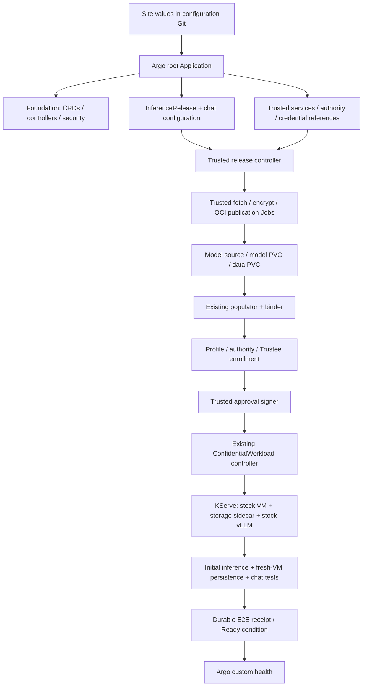

# Full lifecycle GitOps: implementation plan

**Goal:** on an installed, compatible CoCo Validated Pattern, supply one public
site YAML and bootstrap access once. Argo CD then deploys a verified Qwen/KServe
chat demo with an OCI-populated encrypted RO `/model` and guest-initialized,
persistent encrypted RW `/data`. No manual per-release key enrollment, package
signing, manifest copying or acceptance commands.

**Status:** the manual path is qualified. The initial `InferenceRelease` controller
and stage-Job runner passed a fresh add-on installation: six first-attempt image
builds and eight initial Jobs, including fresh-VM persistence, with no manual
fixes/retries. See the [recorded evidence](../tests/evidence/2026-10-15/controller-fresh-e2e.json).
An earlier qualification separately tested controller restart recovery.
The [controller runbook](demo/controller.md) is the implemented API contract. Full
foundation GitOps and lifecycle hardening below remain target work.

The initial administrator integration bootstrap now has an implementation:
[site YAML and credential-file workflow](demo/stock-bootstrap.md). It configures
Vault enrollment and the Git-owned Trustee/ESO mapping; it does not move Vault
administrator credentials into the release controller. Live bootstrap and scoped
login passed using the existing compatible chart; conversion of a fresh stock
chart has local/OPA coverage, with fresh stock-chart E2E qualification still open.

## Two required delivery paths

| Path | User operation | Execution |
| --- | --- | --- |
| **Manual quickstart first** | Run documented Make targets in order, or an explicit aggregate `quickstart-all` | Make invokes shared tools/Jobs, records receipts and prints the next command; no new release controller required |
| **GitOps/controller** | Bootstrap once; commit site YAML | Argo installs services and release intent; the release controller invokes the same tools/Jobs and verifies the same receipts |

The manual path still uses the existing volume populator, ConfidentialVolume/
workload controller, KServe and guest sidecar. It replaces only the **new release
orchestrator**. It is a supported operating path, not a temporary debugging script.
No two executors may manage the same release concurrently; handover must validate
existing identities/receipts and explicitly transfer orchestration ownership.

The [manual quickstart specification](demo/quickstart-implementation-plan.md)
defines all Make targets, expected outputs, follow-ups and image-build requirements.
The agreed starting platform is OpenShift + CoCo already installed.
The manual `qs-*` targets now exist; see the [executable quickstart](demo/quickstart.md).
The initial release-controller path passed its independent E2E qualification;
full foundation and multi-release lifecycle steps below remain open.

## Scope and decisions

- Keep stock Kata, OSC, vLLM, KServe and Trustee. Add orchestration in this repository.
- Use existing OpenShift GitOps/Argo CD. No second workflow engine is required:
  one new **trusted release controller**, Kubernetes Jobs and durable receipts suffice.
  Keep a CLI interface to every shared stage so Make can operate without that controller.
- First qualify the existing `osc-snp-nvidia-x86_64-v1` profile. Architecture stays
  profile-driven; additional hardware requires its own launch/appraisal adapter and E2E.
- Use immutable model digests and explicit release identities. Initial delivery
  supports one predictor and exclusive RW storage; no automatic rolling upgrade
  of the same writable volume under a changed policy.
- One-time administrator configuration establishes allowed profiles, model sources,
  namespaces, backend paths and signer authority. A release cannot expand that grant.

## User contract and proposed API

Extend the current site-values schema rather than creating another input file.
Preserve existing `installation`, `base`, `images`, `registry` and `chat` fields.
Add trusted-integration references and declarative release intent. Example fragment
below is the **future consolidated interface**. The initial controller instead
references an immutable ConfigMap containing the existing public site values;
see the controller runbook for its accepted schema:

```yaml
trusted:
  namespace: inference-preparation
  enrollmentIdentityRef: trustee-demo-enroller
  backendMappingRef: demo-key-backend
  approvalSignerRef: demo-release-signer
  authority:
    stateClaim: inference-authority-state
    credentialsRef: inference-authority-tls
    retention: Retain
release:
  name: qwen-demo-001
  profile: osc-snp-nvidia-x86_64-v1
  model:
    sourceManifestRef: qwen3-0-6b-pinned  # Reviewed manifest pins files and hashes
    publicationRepository: demo-models
  volumes:
    - name: model
      role: model
      mountPath: /model
      size: 2Gi
      lifecycle: PopulateReadOnly
    - name: data
      role: data
      mountPath: /data
      size: 1Gi
      lifecycle: CreateAndInitialize
  acceptance:
    mode: FreshDemo
    runId: initial
    allowTestVMReplacement: true
```

Argo renders an add-on-owned, namespaced **`InferenceRelease`** from these values.
Its final API group/schema is part of milestone 1; it is not an upstream CoCo API.
Store it in the trusted preparation namespace with an explicitly authorized target
workload namespace. The controller creates the existing `EncryptedModelSource`,
PVC, `ConfidentialVolume` and `ConfidentialWorkload` resources as runtime outputs.
Users do not also declare competing copies of those generated objects.

The release spec pins the profile/model/runtime bundle and declares each volume's
mount and lifecycle. Reject duplicate names/mounts, invalid combinations and
unsupported profiles before creating resources. `CreateAndInitialize` authorizes
only claims created by this release: record their actual UIDs before signing a
first-use plan. It does not authorize formatting a pre-existing claim with the same
name. Retained volumes require an explicit existing identity and matching history.

Status exposes `observedGeneration`, input digest, phase, conditions, resource
UIDs, public receipt references, errors and endpoint. Never put keys, credentials
or plaintext in spec/status/events/logs. Public approval artifacts stay in the
existing controller's protected delivery channel, outside Git.

## Ownership and GitOps structure



The site repository is watched; pattern charts/images are pinned. Replace today's
inline bootstrap `valuesObject` snapshot with configuration rendered from the
watched site YAML. Keep the administrator-controlled root separate from workload
configuration. Reuse compatible existing KServe and shared operators. If KServe
is absent, provide an explicitly enabled, pinned installation path under a single
owner; an incompatible installation must fail preflight. Registry, storage and
CoCo hardware enablement remain declared platform prerequisites.

Use separate restricted AppProjects for installation and trusted
services; expand resource/namespace permissions explicitly, not with wildcards.

Argo owns long-lived services and release intent. The release controller owns Jobs
and generated requests; the populator owns import/prime resources; the workload
controller owns the InferenceService; KServe owns predictor Pods. Avoid shared
spec ownership and blanket `ignoreDifferences`. Health gates must check release
conditions, not merely sync success or TCP readiness. CRD upgrades remain an
administrator-owned stage; do not let multiple Helm applications own shared CRDs.

## Lifecycle and durable state

| State | Action / required completion evidence |
| --- | --- |
| Validating | Verify qualified hardware/runtime, capacity, CSI, KServe, Trustee, registry trust and scoped identities; preserve a public platform receipt |
| Preparing | Create-or-read stable keys in the trusted backend; fetch verified model; encrypt and publish immutable OCI artifact; persist verified descriptor/digests |
| Binding | Create source/claims/workload intent; wait for import and exact PVC UID bindings; reject replacement or unexpected existing resources |
| Measuring | Instantiate reviewed profile; render policy; derive expected CPU launch identity; build authority enrollment plan for those bound volumes |
| Enrolling | Register metadata and first-use plans; package InitData; install exact CPU/GPU + launch/InitData bindings through the Trustee owner; provision keys; verify loaded state |
| Approving | Validate complete receipts against current input digest and UIDs; signer approves the exact package; publish to workload controller |
| Serving | Wait for sidecar/authority readiness, attestation, mounts and KServe inference; reconcile chat against the actual service |
| Verifying | Capture first-run evidence; gracefully replace only the designated test VM; verify persistence and real chat; persist final E2E receipt |
| Ready | Report verified release; maintain credentials and non-disruptive health; do not repeat initialization or destructive acceptance |

Implement step IDs from release UID, immutable input digest and operation. Use
leader election plus per-release coordination; duplicate delivery must be safe.
Persist receipts before advancing. After a lost response, inspect durable backend
state and reconcile the same operation; never blindly regenerate a key or reset
a volume. Job names/output identities are deterministic, and timeouts surface a
condition with the last verified step. Keep sensitive material in scoped backend
storage or private memory-backed mounts, not Job arguments or logs.

Status is a progress index, not the sole source of security history. Authority
history, key identities and protected step receipts survive controller/Job loss.
Retained objects must not be garbage-collected through an owner reference when a
release is deleted. Finalizers and explicit retirement govern destructive cleanup.

## Implementation milestones

| Milestone | Changes and existing code to reuse | Exit gate |
| --- | --- | --- |
| **1. Shared stage contract and feasibility** | Define versioned inputs/receipts and execution ownership; extend the site schema; spike launch calculation and authority enrollment; factor existing release tools into idempotent CLI operations | No undeclared inputs; exact retry/UID/conflict tests; document every public input and external credential |
| **2. Manual build and bootstrap** | Add `make/quickstart.mk` and `scripts/quickstart.py`; build/push controller, populator, helper, authority and preparation images; create scoped identities, retained authority and dependency preflight | Fresh clone + site inputs produces digest-pinned images and foundation; no undeclared binary, anonymous pull or key-bearing build context |
| **3. Complete manual release path** | Wrap publisher, provisioner/binder, profile/render/enroll/package/key-enrollment/signer and chat tools; emit commands/receipts; parameterize site mappings | Explicit Make targets prepare fresh encrypted Qwen, RO/RW PVCs, exact Trustee bindings and running KServe/chat without file editing between stages |
| **4. Manual quickstart E2E and how-to** | Wrap verification and graceful test-VM replacement; collect authority/appraisal evidence; document command → expected output → next action, recovery and access | Execute the guide from empty add-on state with empty build caches; first/reopen tests pass; second invocation preserves keys and initialization history |
| **5. Release controller** | New `components/inference-release-controller/`, chart and `InferenceRelease` CRD; invoke shared operations with durable reconciliation, leases and scoped Jobs | Equivalent release succeeds without Make orchestration; fault injection proves retry/parity and no key leakage |
| **6. Full GitOps integration** | Extend `charts/addon-bootstrap`; watched site YAML, root/child Applications, trusted namespace/project, credential references, release intent and custom health | One bootstrap + Git change drives complete verified demo; Argo sync alone is not Ready; no competing resource writers |
| **7. Lifecycle hardening and parity** | Renewal, recovery, retention, explicit handover/retirement and CI coverage for both entry points; publish concise docs and sanitized receipts | Manual and GitOps paths independently pass clean E2E, interruption/resync, renewal and persistence tests |

Dependencies: 1 → 2 → 3 → 4 → 5 → 6 → 7. Deliver the complete **manual quickstart
before** unattended controller orchestration. The shared stages are the reusable
implementation, not a second set of shell-only business rules. No implementation
time estimate is reliable until the launch/authority feasibility spikes pass.

## Integration details that must be resolved

**Expected launch measurements.** Derive them in the trusted preparation domain
from verified stock firmware/kernel/initrd artifacts and exact launch parameters
(including the qualified VM sizing). Compare with actual SNP evidence. Never
promote an observed host measurement directly into the allowlist. If the exact
stock runtime cannot be reproduced by the calculator, use a reviewed versioned
reference bundle as an explicit input and report that full automatic derivation
is incomplete. InitData/policy hashing already exists; do not confuse it with
CPU launch measurement calculation.

**Authority enrollment while serving.** Today's enrollment Job mounts retained
state and `enroll.py apply` writes SQLite directly. Do not turn that into parallel
Jobs against a serving authority. Add an authenticated, transactional, idempotent
administration interface to our authority with scoped registration operations,
plus a bootstrap-only path. It must preserve all existing history/conflict checks.
This changes an add-on component, not Kata/Trustee. Serialize lifecycle transitions;
unknown ownership or partially initialized state stays blocked for recovery.

**Trustee ownership and resource loading.** The adapter must use the existing
owner's configuration path and verify policy before releasing keys. Model
preparation may stage keys privately before they become active KBS resources.
Parameterize backend paths, ESO projection, namespace and policy bindings. Current
KBS startup copying requires a controlled reload/restart to load new resources:
batch updates and gate any shared restart behind the site's explicit bootstrap
policy, readiness checks and retry limits. Never let Argo and the adapter compete
to rewrite the same owner-managed configuration. Keep the previous working
release available if enrollment fails.

**Automatic approval.** A trusted signer validates a completed receipt chain,
preauthorized profile, exact PVC UIDs, new-volume provenance and loaded Trustee
bindings. It cannot be a general signing endpoint for arbitrary workload input.
Use dedicated service identities and allowlisted targets; no broad cluster-admin
credential in the release controller. Accepted Git changes exercise only the
administrator's previously delegated release policy.

**Renewal and upgrades.** Renew registry credentials before expiry and verify the
running KBS uses the replacement. Coordinate authority certificates, trust pins
and approvals; changing measured configuration requires repackaging/re-attestation.
Use durable renewal receipts, not a new destructive acceptance run. Policy-changing
RW reuse needs an explicit migration design: the existing enrollment code correctly
rejects conflicting policy. Initial automation must surface that boundary rather
than bypass it. Key rotation and arbitrary workload upgrades are later workflows.

## Acceptance and completion criteria

1. Start from CoCo with working CPU/GPU attestation and declared registry/CSI/KServe/
   GitOps prerequisites. Create a new add-on namespace, keys, model publication,
   claims and authority state. No reused approvals or prepopulated volumes.
2. Test both entry points on separate fresh release identities. For manual mode,
   follow the Makefile how-to, including builds and pushes; each target prints its
   result and next command. For GitOps, bootstrap once, commit site YAML and observe
   Argo/release status. Neither path requires hand-editing generated digests, PVC
   UIDs, policy hashes or approval artifacts.
3. Prove model hashes and RO mount, GPU computation/inference, unprivileged vLLM,
   private helper interfaces and denied administrator exec.
4. Fsync a `/data` canary; replace the designated VM; require different Pod/boot
   IDs, identical claim identities/canary and unchanged completed formatting steps.
   Send an actual prompt through chat after replacement.
5. Repeat Argo sync; restart the release controller and interrupt Jobs at each
   external-write boundary. Require no new keys, duplicate initialization or loss
   of history. Reject stale receipts, replaced PVCs, tampered ciphertext, invalid
   bindings and unsupported profiles. Retry uncertain Trustee updates by inspection.
6. Exercise credential renewal and authority recovery. Delete only disposable
   compute/Job resources; verify retained data, keys and history survive. Confirm
   Argo health distinguishes Progressing, failed release and verified Ready.

Store sanitized machine-readable evidence with code/image/profile/input digests.
A fresh add-on test on existing CoCo proves add-on reproducibility; a claim of
fresh-platform reproducibility additionally requires a separate CoCo reinstall
and the same test. Do not conflate the two.

**Out of initial scope:** qualifying other hardware, multi-writer RW storage,
general RW snapshot anti-replay, model-key rotation and TLS terminating inside
the inference VM. The existing HTTP chat remains a demo transport limitation;
this automation does not change the prompt confidentiality boundary.
