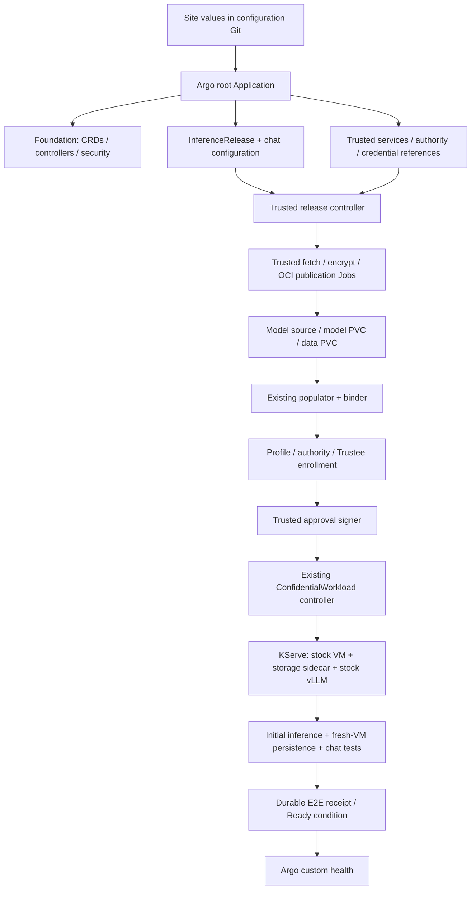

# Full lifecycle GitOps: implementation plan

**Goal:** on an installed, compatible CoCo Validated Pattern, supply one public
site YAML and bootstrap access once. Argo CD then deploys a verified Qwen/KServe
chat demo with an OCI-populated encrypted RO `/model` and guest-initialized,
persistent encrypted RW `/data`. No manual per-release key enrollment, package
signing, manifest copying or acceptance commands.

**Status:** proposed work, not an implemented API. The existing staged demo passed
hardware E2E; [automation.md](automation.md) describes today's boundary.

## Scope and decisions

- Keep stock Kata, OSC, vLLM, KServe and Trustee. Add orchestration in this repository.
- Use existing OpenShift GitOps/Argo CD. No second workflow engine is required:
  one new **trusted release controller**, Kubernetes Jobs and durable receipts suffice.
- First qualify the existing `osc-snp-nvidia-x86_64-v1` profile. Architecture stays
  profile-driven; additional hardware requires its own launch/appraisal adapter and E2E.
- Use immutable model digests and explicit release identities. Initial delivery
  supports one predictor and exclusive RW storage; no automatic rolling upgrade
  of the same writable volume under a changed policy.
- One-time administrator configuration establishes allowed profiles, model sources,
  namespaces, backend paths and signer authority. A release cannot expand that grant.

## User contract and proposed API

Extend the current site-values schema rather than creating another input file.
Preserve existing `installation`, `base`, `images`, `registry` and `chat` fields.
Add trusted-integration references and declarative release intent. Example fragment
below is **proposed**, not accepted by today's installer:

```yaml
trusted:
  namespace: inference-preparation
  enrollmentIdentityRef: trustee-demo-enroller
  backendMappingRef: demo-key-backend
  approvalSignerRef: demo-release-signer
  authority:
    stateClaim: inference-authority-state
    credentialsRef: inference-authority-tls
    retention: Retain
release:
  name: qwen-demo-001
  profile: osc-snp-nvidia-x86_64-v1
  model:
    sourceManifestRef: qwen3-0-6b-pinned  # Reviewed manifest pins files and hashes
    publicationRepository: demo-models
  volumes:
    - name: model
      role: model
      mountPath: /model
      size: 2Gi
      lifecycle: PopulateReadOnly
    - name: data
      role: data
      mountPath: /data
      size: 1Gi
      lifecycle: CreateAndInitialize
  acceptance:
    mode: FreshDemo
    runId: initial
    allowTestVMReplacement: true
```

Argo renders an add-on-owned, namespaced **`InferenceRelease`** from these values.
Its final API group/schema is part of milestone 1; it is not an upstream CoCo API.
Store it in the trusted preparation namespace with an explicitly authorized target
workload namespace. The controller creates the existing `EncryptedModelSource`,
PVC, `ConfidentialVolume` and `ConfidentialWorkload` resources as runtime outputs.
Users do not also declare competing copies of those generated objects.

The release spec pins the profile/model/runtime bundle and declares each volume's
mount and lifecycle. Reject duplicate names/mounts, invalid combinations and
unsupported profiles before creating resources. `CreateAndInitialize` authorizes
only claims created by this release: record their actual UIDs before signing a
first-use plan. It does not authorize formatting a pre-existing claim with the same
name. Retained volumes require an explicit existing identity and matching history.

Status exposes `observedGeneration`, input digest, phase, conditions, resource
UIDs, public receipt references, errors and endpoint. Never put keys, credentials
or plaintext in spec/status/events/logs. Public approval artifacts stay in the
existing controller's protected delivery channel, outside Git.

## Ownership and GitOps structure



The site repository is watched; pattern charts/images are pinned. Replace today's
inline bootstrap `valuesObject` snapshot with configuration rendered from the
watched site YAML. Keep the administrator-controlled root separate from workload
configuration. Reuse compatible existing KServe and shared operators. If KServe
is absent, provide an explicitly enabled, pinned installation path under a single
owner; an incompatible installation must fail preflight. Registry, storage and
CoCo hardware enablement remain declared platform prerequisites.

Use separate restricted AppProjects for installation and trusted
services; expand resource/namespace permissions explicitly, not with wildcards.

Argo owns long-lived services and release intent. The release controller owns Jobs
and generated requests; the populator owns import/prime resources; the workload
controller owns the InferenceService; KServe owns predictor Pods. Avoid shared
spec ownership and blanket `ignoreDifferences`. Health gates must check release
conditions, not merely sync success or TCP readiness. CRD upgrades remain an
administrator-owned stage; do not let multiple Helm applications own shared CRDs.

## Lifecycle and durable state

| State | Action / required completion evidence |
| --- | --- |
| Validating | Verify qualified hardware/runtime, capacity, CSI, KServe, Trustee, registry trust and scoped identities; preserve a public platform receipt |
| Preparing | Create-or-read stable keys in the trusted backend; fetch verified model; encrypt and publish immutable OCI artifact; persist verified descriptor/digests |
| Binding | Create source/claims/workload intent; wait for import and exact PVC UID bindings; reject replacement or unexpected existing resources |
| Measuring | Instantiate reviewed profile; render policy; derive expected CPU launch identity; build authority enrollment plan for those bound volumes |
| Enrolling | Register metadata and first-use plans; package InitData; install exact CPU/GPU + launch/InitData bindings through the Trustee owner; provision keys; verify loaded state |
| Approving | Validate complete receipts against current input digest and UIDs; signer approves the exact package; publish to workload controller |
| Serving | Wait for sidecar/authority readiness, attestation, mounts and KServe inference; reconcile chat against the actual service |
| Verifying | Capture first-run evidence; gracefully replace only the designated test VM; verify persistence and real chat; persist final E2E receipt |
| Ready | Report verified release; maintain credentials and non-disruptive health; do not repeat initialization or destructive acceptance |

Implement step IDs from release UID, immutable input digest and operation. Use
leader election plus per-release coordination; duplicate delivery must be safe.
Persist receipts before advancing. After a lost response, inspect durable backend
state and reconcile the same operation; never blindly regenerate a key or reset
a volume. Job names/output identities are deterministic, and timeouts surface a
condition with the last verified step. Keep sensitive material in scoped backend
storage or private memory-backed mounts, not Job arguments or logs.

Status is a progress index, not the sole source of security history. Authority
history, key identities and protected step receipts survive controller/Job loss.
Retained objects must not be garbage-collected through an owner reference when a
release is deleted. Finalizers and explicit retirement govern destructive cleanup.

## Implementation milestones

| Milestone | Changes and existing code to reuse | Exit gate |
| --- | --- | --- |
| **1. Contract and reconciliation skeleton** | New `components/inference-release-controller/` and chart/CRD; extend `values.schema.json` and `scripts/addon.py`; validation, conditions, leases, receipt storage and ownership checks | Fake-backend tests prove deterministic retry, UID replacement rejection, spec-change handling and no keys in status/logs |
| **2. Portable installation and bootstrap** | Publish pinned controller/populator/helper/authority/preparation images; extend `charts/addon-bootstrap`; install trusted namespace, external credential references and retained authority; dependency ownership/preflight and custom Argo health | One bootstrap plus site YAML installs foundation from portable artifacts; resync makes no additional identities or state |
| **3. Trusted preparation and volume creation** | Wrap existing publisher tools, `charts/model-publisher`, release/provisioning and binder functions in bounded Jobs; durable key staging and OCI receipts | Fresh model publication and blank data claim; interrupted publication resumes with the same key; importer receives ciphertext only |
| **4. Measurements and authority enrollment** | Reuse `profile.py`, `render.py`, `enroll.py`, `package.py`; add qualified launch calculation adapter and serialized authenticated authority administration | No manual measurement/metadata transfer; negative profile/launch/UID tests fail closed; authority restart preserves exact plans |
| **5. Trustee integration and signing** | Refactor `key_enrollment.py` into backend/owner adapters; remove fixed Vault/ESO mapping; automate exact binding verification and `approve.py` signing | Matching CPU/GPU launch/InitData can obtain keys; mismatches cannot; partial updates resume without broadening policy |
| **6. Serving and executable acceptance** | Connect generated package to existing workload controller; render chat; run `scripts/verify-demo.py` through a scoped test runner; publish custom health | Fresh RO/RW Qwen E2E, exec denial, actual chat, fresh-VM persistence and stable identity/history checks all pass |
| **7. Lifecycle hardening and handover** | Credential renewal, retained-state recovery, retirement flow, failure injection, concise operator docs and public sanitized receipts | Resync/restart/renewal tests pass; documented recovery preserves keys/data; clean add-on install completes without per-stage commands |

Dependencies: 1 → 2 → 3 → 4 → 5 → 6 → 7. Prove the launch-measurement adapter
and authority enrollment interface early during milestone 1: they are feasibility
gates, not tasks to defer until integration. No implementation time estimate is
reliable until those two spikes pass.

## Integration details that must be resolved

**Expected launch measurements.** Derive them in the trusted preparation domain
from verified stock firmware/kernel/initrd artifacts and exact launch parameters
(including the qualified VM sizing). Compare with actual SNP evidence. Never
promote an observed host measurement directly into the allowlist. If the exact
stock runtime cannot be reproduced by the calculator, use a reviewed versioned
reference bundle as an explicit input and report that full automatic derivation
is incomplete. InitData/policy hashing already exists; do not confuse it with
CPU launch measurement calculation.

**Authority enrollment while serving.** Today's enrollment Job mounts retained
state and `enroll.py apply` writes SQLite directly. Do not turn that into parallel
Jobs against a serving authority. Add an authenticated, transactional, idempotent
administration interface to our authority with scoped registration operations,
plus a bootstrap-only path. It must preserve all existing history/conflict checks.
This changes an add-on component, not Kata/Trustee. Serialize lifecycle transitions;
unknown ownership or partially initialized state stays blocked for recovery.

**Trustee ownership and resource loading.** The adapter must use the existing
owner's configuration path and verify policy before releasing keys. Model
preparation may stage keys privately before they become active KBS resources.
Parameterize backend paths, ESO projection, namespace and policy bindings. Current
KBS startup copying requires a controlled reload/restart to load new resources:
batch updates and gate any shared restart behind the site's explicit bootstrap
policy, readiness checks and retry limits. Never let Argo and the adapter compete
to rewrite the same owner-managed configuration. Keep the previous working
release available if enrollment fails.

**Automatic approval.** A trusted signer validates a completed receipt chain,
preauthorized profile, exact PVC UIDs, new-volume provenance and loaded Trustee
bindings. It cannot be a general signing endpoint for arbitrary workload input.
Use dedicated service identities and allowlisted targets; no broad cluster-admin
credential in the release controller. Accepted Git changes exercise only the
administrator's previously delegated release policy.

**Renewal and upgrades.** Renew registry credentials before expiry and verify the
running KBS uses the replacement. Coordinate authority certificates, trust pins
and approvals; changing measured configuration requires repackaging/re-attestation.
Use durable renewal receipts, not a new destructive acceptance run. Policy-changing
RW reuse needs an explicit migration design: the existing enrollment code correctly
rejects conflicting policy. Initial automation must surface that boundary rather
than bypass it. Key rotation and arbitrary workload upgrades are later workflows.

## Acceptance and completion criteria

1. Start from CoCo with working CPU/GPU attestation and declared registry/CSI/KServe/
   GitOps prerequisites. Create a new add-on namespace, keys, model publication,
   claims and authority state. No copied lab approvals or prepopulated volumes.
2. Bootstrap once, commit one site YAML, then observe only Argo/release status.
   No operator copies digests, supplies PVC UIDs or runs enrollment/signing commands.
3. Prove model hashes and RO mount, GPU computation/inference, unprivileged vLLM,
   private helper interfaces and denied administrator exec.
4. Fsync a `/data` canary; replace the designated VM; require different Pod/boot
   IDs, identical claim identities/canary and unchanged completed formatting steps.
   Send an actual prompt through chat after replacement.
5. Repeat Argo sync; restart the release controller and interrupt Jobs at each
   external-write boundary. Require no new keys, duplicate initialization or loss
   of history. Reject stale receipts, replaced PVCs, tampered ciphertext, invalid
   bindings and unsupported profiles. Retry uncertain Trustee updates by inspection.
6. Exercise credential renewal and authority recovery. Delete only disposable
   compute/Job resources; verify retained data, keys and history survive. Confirm
   Argo health distinguishes Progressing, failed release and verified Ready.

Store sanitized machine-readable evidence with code/image/profile/input digests.
A fresh add-on test on existing CoCo proves add-on reproducibility; a claim of
fresh-platform reproducibility additionally requires a separate CoCo reinstall
and the same test. Do not conflate the two.

**Out of initial scope:** qualifying other hardware, multi-writer RW storage,
general RW snapshot anti-replay, model-key rotation and TLS terminating inside
the inference VM. The existing HTTP chat remains a demo transport limitation;
this automation does not change the prompt confidentiality boundary.
