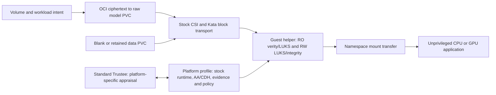

# Porting to other confidential hardware

**Current qualification: AMD SEV-SNP + one NVIDIA confidential GPU, using the
pinned OSC guest and NVIDIA vLLM image.** CPU-only and Intel TDX are porting
targets, not working installer options. Changing `installation.profile` or a
RuntimeClass alone is insufficient: several add-on paths enforce SNP/NVIDIA.
The runtime YAML under `profiles/runtime/` is documentation, not an installed CRD
that discovers or enables hardware support.

The goal for each port is unchanged upstream Kata/agent, AA/CDH and application
images, with platform-specific changes confined to this add-on. First verify
that the chosen stock CoCo/OSC release provides the necessary guest, attester,
kernel and block-device transport. If it does not, record that platform gap;
do not describe a custom guest as a stock-runtime port.

## What stays the same

The volume contracts, OCI population, encrypted disk formats, authority ownership
and initialization journal, and mount handoff need no new hardware-specific
design. They still require validation on the chosen kernel/CSI. `/model` remains
RO and `/data` RW; the backend stores ciphertext. The application has no storage
capabilities, raw disks or private key sockets. The sidecar remains trusted guest
root. CPU-only still means a confidential **CPU VM**, not an ordinary container.

## Choose the first port

| Target | Required differences | Retain |
| --- | --- | --- |
| SNP, CPU-only | CPU-capable inference image/arguments; no GPU requests, device setup, CUDA probe or GPU appraisal; reviewed CPU-only policy and evidence path | SNP launch/InitData verification, CPU TCB appraisal, both storage paths and app isolation |
| TDX, CPU-only | Above plus stock TDX guest/AA, quote transport and collateral, TDX measurement/reference policy, TDX InitData binding | Standard Trustee, authenticated lifecycle/key requests and the storage architecture |
| TDX + confidential GPU | TDX port plus compatible stock GPU guest/driver, GPU passthrough and composite CPU/GPU attestation | Mandatory GPU evidence and binding to the same CPU session; never fall back to CPU-only |

Start with **SNP CPU-only** to separate removal of GPU assumptions from changing
the TEE. Then qualify TDX CPU-only; GPU support is a separate qualification.
A CPU image must support the chosen Qwen model and fit the VM's memory budget.
Select and pin that image rather than assuming the current NVIDIA image runs on CPU.

## Where code needs work

All paths below are in this repository. These are implementation tasks, not
instructions to remove checks or relax the existing qualified profile.

| Area / source entry point | Porting work |
| --- | --- |
| [Profiles](../profiles/README.md), [installer validation](../scripts/addon.py) | Add an explicit reviewed profile, artifact lock and capability selection. Keep the SNP/NVIDIA profile unchanged; reject unsupported combinations. |
| [Preflight](../scripts/quickstart/platform.py), [build](../scripts/quickstart/build.py), [release preparation](../scripts/quickstart/release.py) | Select nodes without requiring a GPU for CPU-only; select the appropriate guest artifacts, sizing and measurement method. Current measurement uses `sevsnpmeasure` and a fixed SNP artifact lock. |
| [Payload extraction](../components/confidential-storage-sidecar/prepare-payload.py), [guest supervisor](../components/confidential-storage-sidecar/runtime.py) | Replace fixed GPU-initrd/tool hashes and exact kernel assumptions with approved profile data; package matching unmodified AA/CDH and compatible storage modules. Select guest attestation devices by TEE: current code requires `/dev/sev-guest`. Make NVIDIA setup conditional. |
| [Private AA client](../components/confidential-storage-client/src/private_rcar_aa.rs) | Current path requires SNP and NVIDIA composite evidence. Add explicit CPU-only and TDX evidence construction; preserve nonce/session-public-key binding and private sockets. |
| [Authority RCAR gateway](../components/confidential-storage-authority/rcar_gateway.py), [KBS client](../components/confidential-storage-authority/kbs_rcar.py), [appraisal verifier](../components/confidential-storage-authority/attestation.py) | Current gateway requires exactly SNP + NVIDIA and KBS auth sends `tee: snp`. Add profile-selected evidence/appraisal contracts. The verifier recognizes TDX in some checks, but this is not an end-to-end TDX implementation. |
| [Release renderer](../components/inference-release/render.py), [agent-policy renderer](../components/confidential-storage-sidecar/policy.py), [inference chart](../charts/inference-release/templates/release.yaml) | Replace fixed GPU RuntimeClass, `gpuCount: 1`, GPU resources and CUDA-specific serving arguments with reviewed profile choices. Generate exact image, environment, device and mount policy for the new stock images. Preserve UID 1001, zero app capabilities and exec denial. |
| [Startup checks](../components/inference-release/startup.py), [demo verifier](../scripts/verify-demo.py), [quickstart verification](../scripts/quickstart/verify.py) | CPU-only replaces the CUDA probe with real CPU inference; TDX uses its actual verified appraisal claims. Retain RO hashes, RW first use/reopen, app privilege and failure checks. |

Audit the guest's mount syscalls (`open_tree`, `setns`, `move_mount`), private mount
behavior, device-mapper targets, ext4, crypto algorithms and module ABI. The current
helper also assumes x86_64 and `sd*` block-device names. A different architecture
or block transport needs explicit adaptation, not just new measurement values.
Recheck SCC/admission and stock agent policy against the exact rendered Pod.

## Attestation changes, especially TDX

Keep **two** enforced decisions: Trustee releases only the bound resources, and
the authority verifies a fresh request/session-bound appraisal before issuing a
lifecycle permit. Configure both for the selected platform. A CPU-only profile
intentionally requires CPU evidence only; it must never be selected automatically
because GPU evidence was missing from a GPU workload.

For TDX, start with a minimal stock confidential Pod and prove successful stock
AA → Trustee attestation and key delivery before adding storage. Verify the quote
generation path, certificate/collateral retrieval and TCB policy for that platform.
Use the selected release's actual claims and independently approved boot reference
values; the SNP launch-digest calculation is not a TDX measurement procedure.

Upstream CoCo binds InitData through **TDX MR_CONFIG_ID**, versus **SNP HOST_DATA**.
The stock AA must validate the supplied InitData against that hardware binding;
Trustee must enforce the approved value. MRTD/RTMR boot measurements are additional
platform-specific checks, not interchangeable names for InitData. See upstream
[InitData](https://confidentialcontainers.org/docs/features/initdata/) and
[attestation policies](https://confidentialcontainers.org/docs/attestation/policies/).
Confirm behavior against the pinned binaries; documentation for another release
is not evidence that the installed guest supports it.

## Bring-up order and acceptance

1. **Record inputs:** CPU/TEE, optional GPU, OpenShift/OSC/KServe versions,
   RuntimeClass/handler, guest artifact hashes, stock application digest, raw Block
   StorageClass/access mode, Trustee URL/CA/policy owner and attestation services.
   Reuse [the input checklist](inputs.md); keep credentials outside Git.
2. **Prove stock platform operation:** boot an isolated confidential Pod; validate
   attestation, InitData binding and protected key delivery. For GPU, also prove
   confidential mode and CPU/GPU evidence binding. Do not enroll an arbitrary
   observed measurement as trusted merely because the VM booted.
3. **Implement the profile and add-on adapters above.** Build/pin the helper and
   preparation images from reviewed stock artifacts. Generate fresh exact agent
   policy, InitData and reference bindings; never reuse another profile's approval.
4. **Prove storage independently:** populate a new model PVC from OCI; attach a
   fresh blank RW PVC; verify private key retrieval, model hashes, RO write denial,
   explicit first-use authorization and an unprivileged consumer with no key API.
5. **Run real inference and chat.** Record the intended CPU/GPU backend and app
   privilege checks. Create a durable `/data` canary, replace the predictor with
   a fresh VM, and prove reopen/persistence without reformatting.
6. **Exercise denials:** altered InitData, unapproved boot identity, missing required
   evidence, wrong volume identity, corrupted model/root and unauthorized RW
   initialization must fail closed. Verify administrator exec remains denied.
7. **Publish qualification:** add sanitized evidence and update the support table
   only after these gates pass. Run both manual and controller release paths; unit
   tests alone do not qualify hardware. Keep keys, tokens and approvals out of Git.

Use the existing [manual quickstart](demo/quickstart.md) as the stage-by-stage
bring-up harness after implementing profile support, then the
[release controller](demo/controller.md). Neither path currently accepts CPU-only
or TDX. No hardware qualification is claimed by this porting guide.
