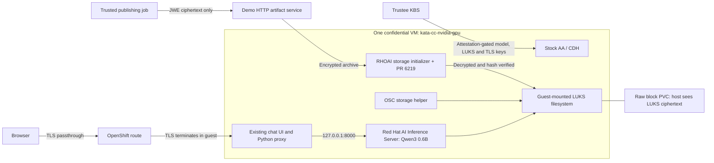

# Confidential Qwen with RHOAI

This extension uses RHOAI 3.6 EA2 confidential model loading and the OSC 1.13.1
storage helper. The model, its decrypted weights, the inference process and the
chat proxy run in one AMD SEV-SNP confidential VM with an attested NVIDIA GPU.
This is an Early Access / Developer Preview demonstration, not a supported
production configuration. The local initializer derivative is also unsupported.

## Ownership and deployment

The normal CoCo pattern owns OSC, Kata, GPU setup, Trustee, Vault/ESO and block
storage. RHOAI owns the serving controllers. The add-on supplies Helm-rendered
`LLMInferenceServiceConfig`, `LLMInferenceService`, raw block PVC, Service,
passthrough Route and application configuration. It does not deploy the previous
custom CSI, model populator, storage authority or release controllers.

The CoCo ClusterGroup enables the `rhoai-platform` Argo Application during
bootstrap. That chart installs the RHOAI operator and serving configuration as a
pattern dependency. Bounded Sync hooks approve only the explicitly pinned initial
InstallPlan, wait for the operator API, then wait for the configured serving
components. An existing different version or a plan containing an unexpected
bundle is rejected. The Subscription stays on Manual approval to prevent
unreviewed future upgrades. These installation hooks run on a stock UBI image;
the RHOAI initializer remains the only derivative image in the extension.

Model-specific work remains explicit: building the image, enrolling keys,
publishing ciphertext and generating the measured workload identity. Committing
the resulting public values enables the model and chat applications. See
[dependency ownership and installation](install.md#dependencies-and-gitops-ownership).

The chat container is part of the RHOAI workload template. The initializer is
explicitly configured (`storageInitializer.enabled: false`) to preserve the
LUKS mount handoff; it invokes the published initializer entrypoint with
`CONFIDENTIAL_ENABLED=true` and `CONFIDENTIAL_RESOURCE_ID`. The model spec also
sets `confidential.enabled` and the same key resource.

The inference server binds guest loopback only. A dedicated OpenShift Route
passes encrypted traffic to the chat server on port 8443. No external inference
API or inference gateway is needed. RHOAI API authentication is disabled for
this loopback-only demo backend; no HTTPRoute is requested. The chat demo has no
user login and must be placed on the intended demo network.

## Storage and restart behavior

The OSC helper opens a raw block PVC inside the guest and keeps its mount alive
as a native restartable init sidecar. Shared process namespace plus the helper's
`/proc/<helper-pid>/root/dev/mapper/mapper` locator lets the initializer and
vLLM mount the already-unlocked XFS filesystem in their own mount namespaces.
The minimal published images use an embedded Python call to the standard Linux
mount operation; no extra storage service or image is introduced. The reference
symlink is unsuitable for Python tarfile's realpath checks, and a bind mount
through that cross-namespace proc link is rejected by Linux. This preview approach requires privileged helper and inference
containers; those processes are in the guest trust boundary.

The claim uses `ReadWriteOncePod`, verified on this cluster's TopoLVM storage, so
only one pod can attach it. The serving rollout uses zero surge. The wrapper
refuses an unknown disk signature, a nonblank initial header region or an
incorrect LUKS passphrase. It never wipes a mismatched header.

On a cold start, the initializer downloads JWE artifacts, decrypts them onto the
LUKS filesystem and verifies every model file against the pinned inventory.
Scratch and download paths remain inside the encrypted filesystem. On subsequent
VM starts it verifies the persisted files and reuses them. A recorded boot ID
supports the fresh-VM persistence check; it is diagnostic evidence, not an
attestation substitute.

## Distribution and provenance

The source is `Qwen/Qwen3-0.6B` at
`c1899de289a04d12100db370d81485cdf75e47ca`. A trusted publishing job verifies the
source inventory and invokes the pinned upstream encryption utility from
Yuval's reference. Each file is compact JWE using A256KW and A256GCM. Only the
encrypted archive is served to the workload.

The initial minimal demo uses the RHOAI initializer's HTTP archive source rather
than adding an S3 service. The archive contains ciphertext; GCM authentication
and the pinned plaintext inventory detect modification. The same workload can
use an S3 source by changing the URI and supplying download credentials. It does
not use unsupported confidential `oci://` or `pvc://` source URIs.

EA2's initializer reads full JWE files into memory. The demo derivative replaces
only the decryptor module with merged upstream PR 6219, pinned in
`build/storage-initializer/provenance.json`. It streams decryption and verifies
the authentication tag before promoting plaintext. Streaming reduces peak RAM;
it does not remove encrypted-plus-plaintext disk requirements or change the
published EA2 support limits. The demo initializer is limited to 1 GiB RAM. A separate cluster regression
job decrypted a 2 GiB file with a 512 MiB limit and approximately 82 MiB peak
RSS; it also rejected a modified authentication tag without promoting plaintext.

## Trust and qualification

Trustee and the publisher are trusted components. In this single-cluster demo,
a cluster administrator can administer Trustee and its keys. Hardware isolation
of the workload does not provide separation from that trusted role. A production
separation requires Trustee and publishing credentials in an independently
administered trusted environment.

The demo is not E2E-qualified until the acceptance record includes a fresh
volume, positive CPU and GPU attestation, actual browser chat, forbidden guest
operations, tampered or unapproved guest denial, and fresh-VM volume reuse.
The measured guest policy binds image digests, container commands, approved
environment values and the guest-memory storage handoff. Startup commands copy
embedded scripts and the chat files into guest-private tmpfs, check their SHA-256
inventory, and execute that copy. This avoids a host ConfigMap update changing
code after verification. Interactive exec, policy replacement, host writes to
private guest paths, additional container commands and arbitrary images are
denied. Qualification is recorded separately after hardware validation.

## Sources

- [Red Hat confidential serving guide](https://access.redhat.com/articles/7149016)
- [Yuval's shared reference](https://github.com/aicatalyst-team/confidential-model-serving/tree/ed79cc4e7fae49d6d50ea26b454c204ced2d69f7)
- [Streaming decryption fix](https://github.com/kserve/kserve/pull/6219)
- [OSC 1.13 bare-metal configuration](https://docs.redhat.com/en/documentation/openshift_sandboxed_containers/1.13/html/deploying_confidential_containers_on_bare-metal_servers/configure-cc-overview_metal-cc)
