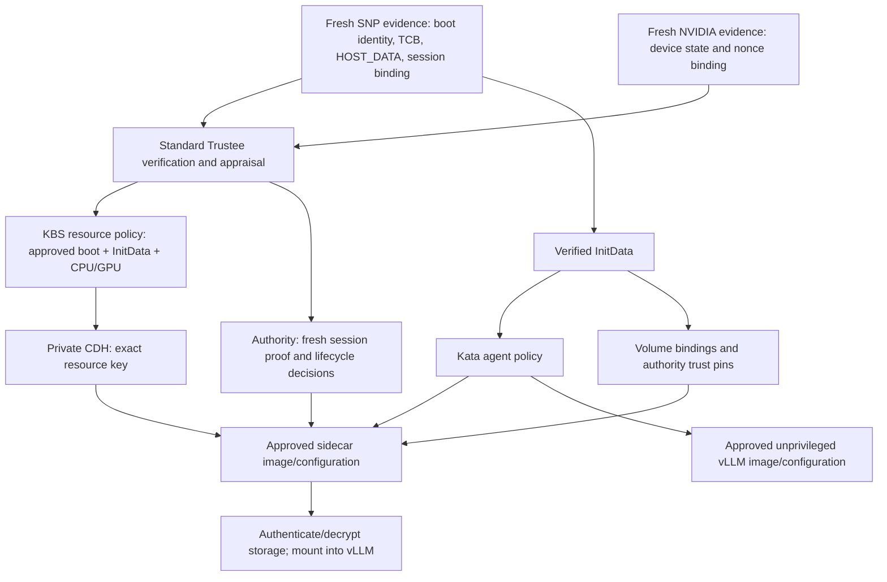

# Security model and attestation chain

Scope: the qualified SNP/NVIDIA sidecar deployment. Stock Kata/agent, AA/CDH,
vLLM and standard Trustee are reused. This describes implemented controls and
their limits, not a production security certification. For execution details see
the [workload walkthrough](workload-walkthrough.md); other TEEs require
[porting and qualification](hardware-porting.md).

## InitData: public configuration bound to hardware evidence

**InitData is a TOML document containing the configuration the guest must enforce.**
It contains no volume keys. In this add-on its exact serialized bytes are hashed
with SHA-256, compressed/base64-encoded for the Pod's `cc_init_data` annotation,
and bound at VM launch through SNP `HOST_DATA`. AA verifies the supplied document
against that hardware binding. Trustee requires the approved InitData value;
choosing an arbitrary document and its matching hash does not authorize a key.
Upstream uses TDX `MR_CONFIG_ID` for the analogous binding; TDX is not qualified
by this repository. See [upstream InitData](https://confidentialcontainers.org/docs/features/initdata/).

| Entry in this release's InitData | What it binds |
| --- | --- |
| `policy.rego` | Permitted agent requests; exact sidecar/application images, commands, environment, identities, capabilities, devices and mounts |
| `aa.toml` | Private Attestation Agent configuration and KBS endpoint/trust settings |
| `cdh.toml` | CDH KBS configuration, registry CA and scoped registry-credential resource URI |
| `storage-sidecar.json` | Consumer startup command; authority address/public trust pins; volume identities/generations, storage profiles, key URIs, destinations, RO manifest or RW initialization-plan hash |

The [packager](../components/inference-release/render.py) leaves self-referential
InitData/policy hash fields empty inside the embedded service configuration; the
helper derives those values from the verified document/policy. Compression and
base64 are transport encodings, not encryption. ConfigMap delivery is untrusted;
hardware binding authenticates the configuration the helper consumes.

## What is attested, and what is enforced afterward

| Object / assertion | Evidence or enforcement | Not implied |
| --- | --- | --- |
| CPU VM | SNP report, certificate/TCB verification, approved launch measurement and InitData; session data binds the challenge/key | Application binaries loaded later are not directly hashed into the initial VM launch measurement |
| Confidential GPU | NVIDIA evidence appraised in the same attestation flow; nonce binding, secure boot, debug disabled and successful measurements | A GPU allocation or successful CUDA call alone is not attestation; no continuous post-attestation monitoring claim |
| Sidecar and vLLM | Hardware-bound agent policy permits pinned guest-pulled images and exact runtime configuration; trusted guest verifies image content and enforces requests | No separate hardware quote per container; no proof that approved code is vulnerability-free |
| Model | Approved manifest/root, dm-verity authentication of ciphertext including LUKS header, then guest file-hash checks | Model bytes are not themselves part of the CPU launch measurement; model safety/quality is not attested |
| RW data | Approved identity/header/profile, keyed sector integrity and retained initialization/ownership state | No proof of the latest disk snapshot; valid old ciphertext can be replayed |
| Kubernetes/CSI/registry | Supply declarations, transport and ciphertext; guest validates the bound configuration/content | These services and the physical storage hardware are not thereby attested or trusted with plaintext |

Attestation authenticates evidence; appraisal decides whether that evidence is
acceptable. The KBS resource policy separately decides which resource may be
released. These are distinct from the **Kata agent policy**, which constrains
host-to-guest requests. See [upstream policy separation](https://confidentialcontainers.org/docs/attestation/policies/).

## Key release and lifecycle authorization

1. **Trusted preparation:** publisher creates the encrypted model disk; release
   tooling provisions separate model/data LUKS credentials into the existing
   Trustee backend. Public bindings associate each resource with the approved
   launch measurement and InitData. A deployment signer approves the exact public
   package; the namespace controller verifies that signature before deployment.
2. **Guest bootstrap:** the stock guest can obtain the scoped helper-image pull
   credential through Trustee. After the application/GPU is attached, the sidecar
   starts private, unchanged stock AA/CDH binaries and validates InitData. This
   avoids requiring the helper to fetch its own image before it exists.
3. **Lifecycle permission:** the guest creates an ephemeral P-256 signing key.
   The authority relays a fresh standard KBS auth/attest handshake, verifies the
   signed appraisal with a pinned AS key, and requires proof of the guest key for
   the exact request. Signed decisions bind the volume/generation, policy/profile,
   consumer/path, nonce and operation. The authority holds no volume keys.
4. **Resource retrieval:** the guest KBS adapter validates/consumes the lifecycle
   permit, then asks private CDH for the exact allowlisted KBS URI. Standard KBS
   independently enforces its attestation/resource policy and protects the key
   response for the attested session. The lifecycle permit is an add-on guest
   control; standard KBS does not interpret the authority's storage journal.
5. **Use:** the helper opens the approved disk stack and transfers RO `/model`
   and RW `/data` mounts into vLLM. Keys stay in trusted preparation/backend and
   private guest code/kernel mappings; vLLM receives plaintext filesystem access,
   not the key API. CDH can reuse its attested session: every read is not a new quote.

The current [authority verifier](../components/confidential-storage-authority/attestation.py)
requires the exact `cpu0`/`gpu0` appraisal set, `affirming` results and approved
policy/trustworthiness values. Tokens have at most a 300-second lifetime and are
accepted no more than 60 seconds after issuance. Its explicit installed-Trustee
profile permits absent `iss` only with pinned signing identity and a retained
KBS TLS handshake; this is not an unrestricted issuer fallback. NVIDIA nonce-match
verification is combined with the CPU binding of the exact additional-evidence
bytes and session public key. Missing GPU evidence must fail, not select CPU-only.

## Trust boundaries and key holders

| Domain | Trust and exposure |
| --- | --- |
| Hardware/firmware + measured guest | Trust CPU/GPU TEE mechanisms, verified TCB, guest kernel/agent and stock attestation/image handling |
| Guest storage sidecar | Privileged guest root; trusts its supervisor, Rust storage code, AA/CDH, cryptsetup and kernel modules. Can access keys/plaintext and enter the app mount namespace; part of the TCB |
| Application | UID/GID 1001, no capabilities or escalation, read-only root, no raw storage/key sockets. Still trusted with plaintext model/data, prompts and outputs; malicious application code can disclose what it can read |
| Trusted control domain | Publisher, release executor/signer, Trustee/AS, secret backend and authority plus their administrators. Preparation sees plaintext/keys; authority retains metadata, TLS/receipt keys and history; AS retains its signing key |
| Workload host/storage/network | Assumed able to replace configuration/ciphertext, issue agent requests, interrupt I/O and deny service. They must not control the trusted policy/signing/backend domain for the confidentiality claim to hold |

The populator and namespace CV/workload controller need no model/data key. The
**trusted release executor does** handle provisioning credentials and sensitive
retained state; do not conflate these controllers. Colocating Trustee, authority
and release workers on the demo cluster means its administrator can access that
trusted domain. The demo does not protect keys against an administrator who also
controls the key backend or can approve arbitrary measurements/policies.

## Threats, controls and residual limits

| Threat | Control / residual limit |
| --- | --- |
| Host exec, container substitution or mount injection | Measured exact agent policy; admin `ExecProcessRequest` and policy replacement denied; digest-pinned guest pulls. SCC/admission add defense in depth but are not the TEE boundary |
| ConfigMap/policy replacement | AA hardware-binding check plus Trustee approved InitData; signed deployment package is a separate orchestration control |
| Storage theft/tampering | LUKS/dm-crypt encrypts sectors; RO dm-verity authenticates approved ciphertext/root; RW keyed dm-integrity detects sector modification. Authenticated header copies constrain LUKS parsing |
| Model rollback | Exact approved generation/manifest/root; requires trusted approval and authority history. No automatic acceptance of a registry tag's new target |
| RW rollback or duplicate writer | Integrity does not prevent full snapshot replay. Authority serializes owners; clean close precedes release. Crash/uncertain cleanup retains ownership and needs explicit recovery/fencing; no automatic timeout takeover |
| Accidental reformat | Blankness alone is insufficient. New claim UID and initialization plan need explicit approval; durable Started/Complete journal gates format, integrity initialization, filesystem creation and flush |
| Prompt/output disclosure | Current chat proxy and HTTP path are outside the TEE. Encrypted weights do not protect traffic; guest-terminated authenticated TLS is still required for that claim |
| Logs or application exfiltration | Agent policy permits log reads (`ReadStreamRequest`). Never emit keys/plaintext-sensitive data. The deployment does not provide a general application-egress confidentiality guarantee |
| Guest/sidecar exploit, side channels or denial of service | Attestation is not a code audit or continuous runtime protection. No universal side-channel, physical-attack or availability guarantee; privileged guest compromise can expose keys/plaintext |
| Revocation/rotation | Blocking future releases does not retract an already released key or close an existing dm-crypt mapping. Credential renewal, safe replacement/re-encryption and retained-volume upgrades require explicit lifecycle handling |

## Review and verification

Before approving a release, review guest/image digests, exact agent policy,
InitData and per-resource bindings; trusted public keys/CAs; actual claim UIDs,
RO root/manifest and RW first-use plan. A successful boot or self-reported hash is
not an independent approval of unknown code. Sidecar/application changes require
regenerated policy/InitData and fresh approval; guest changes also require updated
boot references and qualification.

The [manual E2E receipt](../tests/evidence/2026-10-15/manual-quickstart-e2e.json)
records demonstrated inference and storage persistence, not a complete adversarial
audit. Use [acceptance checks](demo/acceptance.md) for positive evidence, and test
rejection of changed InitData/boot identity, missing GPU evidence, wrong volume
bindings, corrupted model content and unauthorized initialization. Record which
negative cases were actually exercised; do not infer them all from a passing chat.
