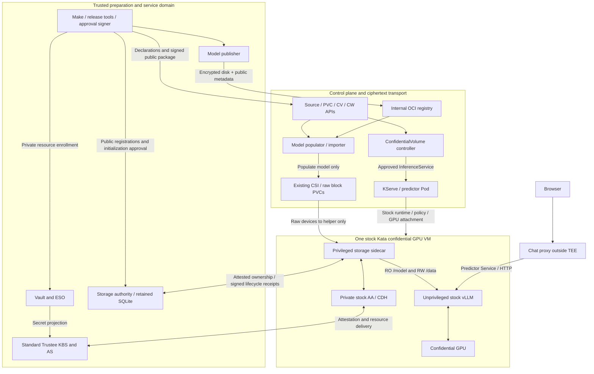
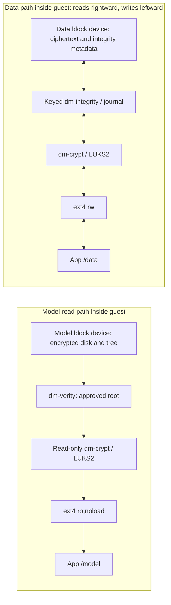

# Qwen workload: declarations to confidential inference

This is the implemented **stock-Kata sidecar** architecture. Qwen3-0.6B runs in
stock vLLM, managed by KServe, inside a confidential GPU VM. `/model` is a
read-only encrypted model disk populated from OCI; `/data` is a separate encrypted
filesystem initialized inside the guest and retained across VM replacement.

Read this with the [component map](components.md). To deploy it, follow the
[manual quickstart](demo/quickstart.md); its Make stages perform the trusted
preparation steps described below. Applying the CRs alone is insufficient.
The [controller path](demo/controller.md) uses the same operations as sequential Jobs
after one-time bootstrap; its independent hardware qualification is pending.
[Recorded E2E](../tests/evidence/2026-10-15/manual-quickstart-e2e.json) covers fresh
add-on installation and two VMs on the [qualified stack](architecture.md#qualified-hardware-and-software).

## 1. System and trust boundaries



The host, registry and block backend need not be trusted with plaintext model/data
or storage keys. Kubernetes transports **public** configuration; guest checks bind
it to the attested workload. The publisher, release signer, Trustee and authority
are trusted. The demo colocates trusted services on the cluster: an administrator
of that domain can access its credentials/history. It is not isolation from that
administrator. Production needs an independently protected trust domain.

## 2. Describe the disks and their use

There are three add-on CRDs, all namespaced `storage.confidentialcontainers.org/v1alpha1`:

| Object | Describes | Does not establish |
| --- | --- | --- |
| `EncryptedModelSource` | Immutable OCI manifest/disk digests, size and format | Permission to decrypt or model freshness |
| Ordinary `PersistentVolumeClaim` | Capacity, CSI allocation, raw Block mode and optional population source | Confidentiality or guest readiness |
| `ConfidentialVolume` (CV) | Exact PVC UID, RO/RW profile, key URI, initialization intent and approved model reference | Permission to format merely because the declaration exists |
| `ConfidentialWorkload` (CW) | Desired KServe application and volume-to-container/path bindings | Permission to deploy before a signed package exists |

Schemas: [source](../charts/vendor/encrypted-model-populator/crds/encryptedmodelsources.yaml),
[CV](../charts/vendor/confidential-volumes/crds/confidentialvolumes.yaml),
[CW](../charts/vendor/confidential-volumes/crds/confidentialworkloads.yaml).
These are this add-on's experimental APIs, not upstream CoCo APIs.

### Source and claims

Illustrative names below; substitute the publisher's digest receipt, your
StorageClass and actual claim UIDs. These fragments explain the API; the
[release chart](../charts/inference-release/templates/release.yaml) and quickstart
generate the complete resources from site values.

```yaml
apiVersion: storage.confidentialcontainers.org/v1alpha1
kind: EncryptedModelSource
metadata: {name: qwen-model, namespace: inference}
spec:
  format: luks-verity-v1
  repository: inference/qwen-model
  manifestDigest: sha256:<OCI-manifest-digest>
  diskDigest: sha256:<encrypted-disk-digest>
  diskBytes: 2147483648
---
apiVersion: v1
kind: PersistentVolumeClaim
metadata: {name: qwen-model, namespace: inference}
spec:
  storageClassName: <block-storage-class>
  volumeMode: Block
  accessModes: [ReadWriteOncePod]
  resources: {requests: {storage: 2Gi}}
  dataSourceRef:
    apiGroup: storage.confidentialcontainers.org
    kind: EncryptedModelSource
    name: qwen-model
---
apiVersion: v1
kind: PersistentVolumeClaim
metadata: {name: qwen-data, namespace: inference}
spec:
  storageClassName: <block-storage-class>
  volumeMode: Block
  accessModes: [ReadWriteOncePod]
  resources: {requests: {storage: 1Gi}}
```

The populator watches `dataSourceRef`; kubelet and the application do not invoke it.
It allocates a temporary **prime PVC** through existing CSI, starts an importer,
verifies OCI/disk digests, writes ciphertext, flushes and reads it back. After the
writer exits, the population library rebinds the populated PV to `qwen-model` and
cleans up temporary resources. An already populated, Bound PVC is reused without
another import. The data PVC has no `dataSourceRef`; it bypasses the populator.

`ReadWriteOncePod` is attachment exclusivity. The model importer writes during
population; the eventual guest mapping and application mount are read-only.
This implementation does not share one model PVC across multiple VMs.

### Confidential behavior

The [binding Job](../scripts/binding.py) waits for Bound claims, verifies their
intent and creates these immutable declarations with **actual** PVC UIDs:

```yaml
apiVersion: storage.confidentialcontainers.org/v1alpha1
kind: ConfidentialVolume
metadata: {name: qwen-model, namespace: inference}
spec:
  claimRef: {name: qwen-model, uid: <actual-model-PVC-UID>}
  access: ReadOnly
  profile: luks-verity-v1
  initialization: {policy: Never}
  keyResource: kbs:///default/model-keys/qwen-model
  content: {approvedManifestRef: qwen-release-1}
---
apiVersion: storage.confidentialcontainers.org/v1alpha1
kind: ConfidentialVolume
metadata: {name: qwen-data, namespace: inference}
spec:
  claimRef: {name: qwen-data, uid: <actual-data-PVC-UID>}
  access: ReadWrite
  profile: luks-integrity-v1
  initialization:
    policy: OnceIfApproved
    filesystem: ext4
    owner: {uid: 1001, gid: 1001}
  keyResource: kbs:///default/model-keys/qwen-data
```

`approvedManifestRef` is a logical reference resolved by the trusted release tools
to reviewed publisher metadata; it is not another CRD or a key. `keyResource` is a
public resource identifier, not the secret. The `model-keys` collection name has
no effect on whether a volume is RO or RW.

The profile selects behavior; the workload binding selects the destination.
Names such as `model` and `data` have no special runtime semantics. Up to eight
volumes can bind to the same consumer with distinct IDs, claims, keys and
non-overlapping paths. The quickstart currently instantiates exactly these two.

### Workload binding

This abridged CW shows the declaration before sidecar injection:

```yaml
apiVersion: storage.confidentialcontainers.org/v1alpha1
kind: ConfidentialWorkload
metadata: {name: qwen, namespace: inference}
spec:
  template:
    metadata:
      name: qwen
      annotations: {serving.kserve.io/deploymentMode: Standard}
    spec:
      predictor:
        minReplicas: 1
        maxReplicas: 1
        deploymentStrategy: {type: Recreate}
        annotations:
          storage.confidentialcontainers.org/bindings: >-
            [{"volume":"model","confidentialVolume":"qwen-model",
              "container":"kserve-container","mountPath":"/model"},
             {"volume":"data","confidentialVolume":"qwen-data",
              "container":"kserve-container","mountPath":"/data"}]
        containers:
          - name: kserve-container
            image: nvcr.io/nvidia/vllm@sha256:<approved-digest>
            command: [python3, -m, vllm.entrypoints.openai.api_server]
            args: [--model, /model, --served-model-name, qwen3-0.6b]
            resources:
              limits: {nvidia.com/pgpu: "1"}
```

The approved renderer adds resource limits, security settings, probes and startup
coordination. vLLM does not reference `EncryptedModelSource` or call the storage
API. It opens ordinary files under `/model`; its cache/temp paths point under
`/data`. Existing CSI and stock Kata transport each claim as a raw block device
**only into the helper**. The app initially receives empty guest-memory mount
targets; decrypted filesystems replace those targets before vLLM starts.

The generated package preserves the binding across each layer:

| Layer | Model example | Data example |
| --- | --- | --- |
| CW binding → CV | `model` → `qwen-model` | `data` → `qwen-data` |
| Helper `volumeDevices` | Bound claim → assigned `/dev/coco-volume-N` | Other claim → a distinct assigned device path |
| Public service configuration | `binding_id`, `transport_path`, authenticated `expected`, approved `manifest` | Same fields plus `initialization_plan_sha256` |
| Guest authority identity | Derived from cluster/namespace/PVC UID; bound to profile/key/generation | Separate identity and durable initialization history |
| Consumer mount | `kserve-container:/model`, RO | `kserve-container:/data`, RW |

Device numbers are generated bindings, not model/data role flags. The guest checks
those bindings against measured configuration and authenticated disk identity.
The application never interprets this configuration; it sees only the final paths.

## 3. Preparation and approval control flow

```mermaid
sequenceDiagram
  participant O as Make / trusted release owner
  participant P as Publisher / OCI
  participant V as Populator / CSI
  participant C as CV controller
  participant A as Authority
  participant T as Vault / ESO / Trustee
  participant K as KServe
  O->>P: Pinned Qwen source + private model credential
  P-->>O: Ciphertext artifact + descriptor + file hashes
  O->>V: Source + model PVC + blank data PVC
  V-->>O: Bound claims with immutable UIDs
  O->>C: CVs + CW
  C-->>O: Immutable request ConfigMap / digest
  O->>O: Render policy; calculate launch; derive initialization plan
  O->>A: Register model identity; approve explicit new RW UID
  O->>O: Package public InitData and expected hashes
  O->>T: Exact launch / InitData bindings; scoped resource enrollment
  O->>A: Serve with pinned policy / InitData and retained state
  O->>C: Signed public deployment approval
  C->>C: Validate signature, expiry, request and artifact bindings
  C->>K: Reconcile approved InferenceService + InitData ConfigMap
```

1. **Build and publish.** Make builds controller, populator, helper, authority and
   preparation images and pins their digests. A trusted CPU-only publisher uses a
   software VM to create a LUKS2 filesystem containing the pinned Qwen files,
   builds a verity tree over the LUKS header and ciphertext, and publishes the disk.
   Plaintext and the encryption credential exist in trusted preparation scratch;
   only ciphertext and public metadata enter OCI. The model/data credentials are
   distinct random 32-byte LUKS unlock secrets; they are not the internal XTS keys.
2. **Resolve identities.** The controller compiles cluster, namespace, CW/CV/PVC
   identities, source digest and desired application into a deterministic request.
   Replacing a PVC with the same name changes its UID and invalidates approval.
3. **Prepare the measured package.** The release tools select the reviewed runtime
   profile, calculate the SNP launch measurement from pinned stock boot bytes and
   render exact Kata policy. They register the model descriptor and explicit
   new-volume initialization intent in the authority. No observed measurement is
   automatically accepted as trusted merely because a VM produced it.
4. **Enroll trust.** Public InitData includes policy, sidecar configuration and
   AA/CDH settings. Its hash and the launch measurement gate three Trustee
   resources: model credential, data credential and scoped helper registry auth.
   The current integration uses Vault → ESO → the standard KBS resource repository,
   with policy updates through the existing CoCo GitOps owner. Newly projected
   resources may require a controlled Trustee restart to load.
5. **Deploy.** A separately held Ed25519 deployment key signs four public files:
   `guest-config.json`, `initdata.toml`, `runtime.json`, `sidecar-deployment.json`.
   The controller verifies the signature, request digest, expiry and bindings,
   publishes immutable configuration and creates/updates only its allowed KServe
   targets. It cannot enroll keys, sign approvals or authorize formatting.

`Approved` means a valid deployment package exists. `Bound` means CSI allocated
storage. Neither means the guest mounted a volume or Trustee released its key.
KServe readiness, guest checks and authority state establish those later stages.

## 4. Boot, attestation and mount transfer

```mermaid
sequenceDiagram
  participant R as Stock Kata runtime / agent
  participant H as Storage sidecar
  participant S as Storage service + client libraries
  participant D as Private stock AA / CDH
  participant T as Standard Trustee
  participant A as Storage authority
  participant L as Application startup / vLLM
  R->>R: Boot VM; bind InitData; enforce agent policy
  R->>T: Stock guest attestation / helper pull credential
  R->>H: Create helper with raw devices
  R->>L: Create consumer; attach confidential GPU
  L->>H: Unix socket rendezvous; wait for READY
  H->>D: Start private AA/CDH after GPU attachment
  D->>D: Verify supplied InitData against SNP HOST_DATA
  H->>H: Authenticate consumer UID, command, capabilities and namespace
  H->>S: activate-many with measured device bindings
  S->>A: Fresh challenge / guest session proof
  A->>T: Relay standard auth/attest; verify signed CPU + GPU appraisal
  A-->>S: Signed lifecycle decisions / exact volume identity
  S->>S: On reopen, authenticate header/profile before key fetch
  S->>D: Get permitted resource via private CDH socket
  D->>T: Attested resource request
  T-->>D: Protected key response
  D-->>S: Key inside private guest memory
  S->>S: Open RO or initialize/reopen RW; verify stack and mount
  S-->>H: Private filesystem mount paths
  H->>L: Transfer mounts; send READY
  L->>L: Verify model/data/GPU; exec stock vLLM
```

There are **two attestation consumers**. The authority relays standard KBS
`/auth` and `/attest` for fresh challenge-bound lifecycle authorization; it checks
signed Trustee appraisal and proof of the guest session key. It does not request
storage resources. Separately, CDH obtains the exact resource from KBS. The
add-on KBS adapter consumes a valid lifecycle permit before making that request.
CDH may reuse its attested session; a successful key request alone is not proof
of a new attestation exchange.

The stock guest can retrieve the helper image's registry credential before the
helper runs. The helper then starts **unchanged AA/CDH binaries copied from the
qualified stock initrd**, with root-private sockets in its own container. This
avoids a bootstrap dependency on an image that has not yet been pulled. Starting
private AA after the GPU consumer exists ensures its additional GPU attester is
selected. AA validates the exact InitData against SNP HOST_DATA; Trustee checks
its approved hash and launch identity. A substituted ConfigMap is insufficient.

### How mounts enter an unprivileged application

The Pod sets `shareProcessNamespace: true`: the sidecar and app share the **guest
PID namespace**, with separate mount namespaces. This exposes guest processes to
the helper; it does not enable the host PID namespace or share filesystem mounts.
The renderer gives raw PVC `volumeDevices` only to the helper. The application
gets memory-backed placeholder directories at the approved mount destinations.

1. The application runs a measured wait command from the existing image and
   connects to `/rendezvous/storage.sock`. vLLM has not started yet.
2. The helper obtains the caller PID/UID/GID using `SO_PEERCRED`. It checks
   UID/GID 1001, the exact startup command, zero effective capabilities and
   `NoNewPrivs`. It retains a pidfd plus descriptors for `/proc/<pid>/root` and
   `/proc/<pid>/ns/mnt`; mount requests do not accept an application-supplied PID.
3. After attestation and storage activation, the filesystems are mounted privately
   in the helper. A forked helper process performs the namespace transfer below.
4. After successful attachment it sends `READY`. The application checks the
   mounts, model hashes, data persistence and GPU, then `exec`s stock vLLM.

```mermaid
sequenceDiagram
  participant H as Privileged helper child
  participant K as Guest Linux kernel
  participant N as Application mount namespace
  H->>K: open_tree(source, OPEN_TREE_CLONE | O_CLOEXEC)
  K-->>H: Detached mount descriptor (no file copy)
  H->>K: setns(pinned application mount namespace)
  H->>K: fchdir(pinned application root); chroot; chdir
  H->>N: move_mount(descriptor, approved destination)
  H->>N: Remount bind with nodev,nosuid,noexec and RO/RW mode
  H-->>H: Exit; parent checks successful completion
```

This is a bind-mount-style attachment using Linux's file-descriptor mount API.
The clone refers to the same guest filesystem; it does not copy model bytes or
export plaintext through a host filesystem. `setns` changes the **helper child's**
namespace, not the application's credentials. The helper retains the privileges
needed for mount operations; vLLM receives only filesystem access. Its read-only
root filesystem is compatible with a separately mounted writable `/data`.

No shared host mount propagation, host mount helper, custom CSI decryptor or
Kata-agent patch is used. Implementation: [renderer and wait command](../components/inference-release/render.py),
[consumer authentication and mount transfer](../components/confidential-storage-sidecar/runtime.py)
(`Consumer.__init__`, `Consumer.transfer`).

The app waits for `READY` before executing vLLM. It has no raw storage devices,
`CAP_SYS_ADMIN`, private CDH socket or volume-key API. The sidecar is privileged
**inside the VM** and is part of the workload's trusted computing base. The
measured policy constrains container creation and denies administrator
`ExecProcessRequest`; the SCC/admission guard additionally restricts use of the
helper's service account on OpenShift.

The sidecar is trusted guest root and can enter the application's namespace;
these containers are not mutually isolated TEEs. On shutdown it stops the
consumer before unmounting and closing storage. Uncertain cleanup retains
authority ownership rather than permitting another writer.

## 5. Storage bytes and lifecycle



| Mechanism | Purpose here | Limit |
| --- | --- | --- |
| LUKS2 + dm-crypt | LUKS stores keyslot/layout metadata; dm-crypt encrypts sectors with AES-XTS | Encryption alone does not authenticate content |
| dm-verity | RO Merkle tree authenticates model ciphertext, including the LUKS header, against an approved root | Immutable content; root must come from trusted approval |
| Keyed dm-integrity | RW sector authentication using HMAC-SHA256; journal supports consistent integrity updates | Does not reject a complete older valid disk snapshot; no general journal-tamper-resistance claim |
| Authority receipts and journal | Bind volume generation, manifest/header, policy, credential URI, consumer/path and owner | Authority history itself needs protected retention and rollback handling |

### Model: open only

The guest authenticates the approved manifest and full 16 MiB LUKS header before
parsing untrusted metadata. It validates the narrow profile, seals the verified
header copy in a memfd and gives that same descriptor to cryptsetup. It verifies
the effective verity/crypt stack, mounts RO, and the demo checks every producer
file hash before inference. The raw host disk cannot substitute another header
between verification and cryptsetup parsing. `initialization: Never` supplies no
format path. Model-generation approval pins an exact root/manifest; changing a
registry tag alone cannot update the mounted model.

### Data: initialize once, then reopen

A blank disk, a missing LUKS header or `OnceIfApproved` alone does **not** authorize
formatting. The trusted release owner must enroll an explicit new-claim UID and
immutable plan: volume identity, size, UUID, profile, key URI, policy and mount.

| Durable authority step | Guest action after permission | Recorded result |
| --- | --- | --- |
| `luks-format` | Create the approved LUKS2 header/keyslot and integrity layout | Header identity |
| `integrity-initialize` | Open the authenticated encryption/integrity stack and initialize its data region | Effective stack digest |
| `filesystem-create` | Create ext4 and set approved filesystem ownership | Filesystem UUID |
| `durability-barrier` | Flush, verify and construct the final manifest | Header/manifest digests |

The authority commits `Started` **before** each execute decision and `Complete`
after a bound result. A duplicate Started request is a reconciliation case, never
a second format permit. All four completions are required before `Ready`.
A later VM gets a new attested owner and reopens the same authenticated header,
key reference and filesystem. It cannot reinitialize a Ready volume.

Storage hardware attestation is not needed for this data-confidentiality model:
the backend supplies untrusted bytes, authenticated/decrypted inside the VM.
It can still delete, withhold or replay data. Keyed integrity is not freshness;
full RW snapshot rollback remains an explicit gap. The authority prevents
unapproved RO identities only while its own history and approval policy are trusted.

### Shutdown and uncertain failure

The helper stops the consumer, removes its transferred mounts, unmounts private
filesystems, closes mappings, and only then releases authority ownership. Recorded
success markers are `SIDECAR_STOPPING_CONSUMER`,
`SIDECAR_CONSUMER_MOUNTS_REMOVED`, `SIDECAR_STORAGE_CLOSED`.
A new VM can acquire ownership after clean closure; it retains the same PVC UIDs,
manifest/header and initialization journal. No timeout automatically transfers
ownership. A busy mount, partial effect, lost acknowledgement or crashed VM may
retain ownership and require explicit recovery with independently established
fencing. Deleting a Pod or CR does not prove safe takeover or erase retained data.

## 6. Inference and the persistent-data test

```text
browser POST /api/chat
  -> chat proxy :8080 (outside TEE)
  -> KServe predictor Service :80
  -> stock vLLM :8000 /v1/chat/completions
  -> Qwen weights read from /model -> guest memory -> confidential GPU
  -> generated tokens -> proxy -> browser
```

The UI sends conversation messages; the proxy adds the configured served-model
name and calls the OpenAI-compatible vLLM API. It has no Kubernetes credential or
exec fallback. The app runs offline from `/model`; cache/temp/home locations are
under `/data`. The demo startup checks write and flush a canary there. After a
fresh VM, they verify the original canary, a different boot ID, the same PVCs and
unchanged initialization history, then repeat GPU inference through the chat API.
This proves filesystem persistence, not that chat conversation history is saved.

The current HTTP proxy runs outside the TEE. Local port-forward uses authenticated
cluster access, but this is **not** guest-terminated TLS or end-to-end confidential
prompt transport. Encrypted weights do not imply confidential network prompts.

## 7. What this adds; what still needs integration

| Layer | Stock behavior reused | Add-on supplied here / remaining gap |
| --- | --- | --- |
| CoCo / OSC / Kata | Confidential VM, GPU attachment, AA/CDH protocols, InitData and agent policy | Sidecar packages tools/modules and private stock binaries; no upstream source patch. Runtime ABI/profile portability still needs qualification |
| Trustee / CoCo VP | KBS/AS, CPU/GPU verification, existing Vault/ESO and GitOps owner | Exact per-release key bindings and scoped enrollment tooling; generic owner interface and credential renewal remain gaps |
| Kubernetes / CSI | Raw Block claims, attachment, custom population plumbing | EncryptedModelSource controller/importer; no custom CSI required for this tested topology |
| Workload API | KServe Standard deployment and Service | CV/CW CRDs, binding Job, signed-package controller, security guard and renderer |
| Guest storage | Kernel device-mapper and namespace APIs | Sidecar supervisor plus storage service/client/key/crypto libraries; stock CoCo does not manage this multi-volume lifecycle |
| Lifecycle trust | Trustee attests the guest | Separate retained authority owns initialization, generation and exclusive owner decisions; production fencing/backup/rollback protection remain |
| Release operations | Helm and existing Argo ownership | Manual Make path builds, publishes, measures, enrolls, signs and tests. The initial InferenceRelease controller runs model-through-report as Jobs after bootstrap; renewal remains planned |

Only the current SNP/NVIDIA, single-replica, RWOP/Immediate storage profile is
qualified. The generic declarations do not establish support for TDX, other GPUs,
shared model claims, larger RW geometry or arbitrary guest/image versions.
See [status](implementation-status.md) for deployment scope and
[automation](automation.md) for the future GitOps boundary.
